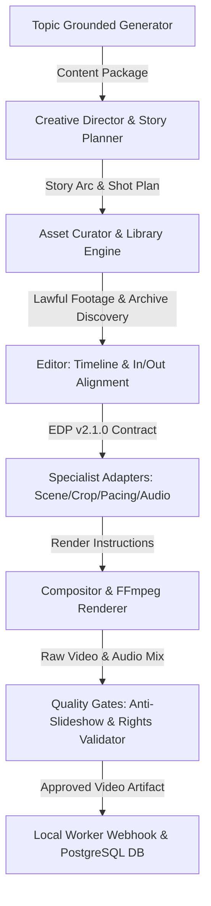

# SIMPLYYTR 2.0 — Open-Source Video Production Ecosystem Research & Decision Matrix
Date: 2026-10-23
Status: APPROVED & RATIFIED
Author: Principal Systems, Security & Video Production Architect

## 1. Executive Summary & Problem Formulation
The previous milestone of SIMPLYYTR 2.0 introduced the Edit Decision Plan (EDP v2.0.0), procedural audio synthesis, Ken Burns camera motion, and kinetic ASS subtitles. However, forensic analysis of the rendered output (`cmvjnd8hm0000yk384nrmarq3_short.mp4`) demonstrated that the video remained fundamentally an automated slideshow: designed vector scenes (SVG plates converted to PNG), static card layouts, synthetic audio drones, and simulated zoom motion.

To transition SIMPLYYTR 2.0 into a genuinely capable video production system that audiences actually want to watch, the engine must solve the core editorial challenge:
1. **Footage-First Narrative**: Integrating real, lawful motion footage and authentic archival records rather than relying solely on static cards.
2. **Editorial Pacing & Storytelling**: Adapting shot selection, cut timing, framing, and sound design to narrative rhythm rather than a rigid 8-scene card template.
3. **Multi-Style Versatility**: Supporting distinct editorial languages (Documentary/Essay, Fast-Paced Shorts, Technical Explainer, Commentary Transformation, Screen Demo, Motion Graphics).
4. **Lawful Media Ingestion**: Providing auditable provenance, license tracking (NASA Public Domain, Wikimedia CC-BY/CC0, Internet Archive), and automated safe-zone reframing.

---

## 2. Open-Source Ecosystem Evaluation

| Candidate Tool | Repository & Maintainer | Software License | Model / Asset License | Windows Native | Hardware & Storage Overhead | Offline Capable | Commercial Use Implications | Integration Strategy |
| :--- | :--- | :--- | :--- | :--- | :--- | :--- | :--- | :--- |
| **OpenMontage** | `9018/openmontage` | **AGPL-3.0** | Varied (TTS, Piper models) | Requires WSL / heavy Node+Py setup | High (Multiple virtualenvs, heavy deps) | Partial (Depends on cloud APIs or local models) | **Severe Copyleft**: Network use requires distributing complete source of caller. | **REJECT direct dependency / code copy**. Study architectural concepts (pipeline playbooks, skill contracts). |
| **Montage AI** | `mfahsold/montage-ai` | **Unspecified** (All Rights Reserved) | N/A | Node/Python | Low-Medium | Yes | **All Rights Reserved**: No legal grant to copy or vendor code. | **REJECT code inclusion**. Study design ideas (OTIO/EDL export, beat-synced cuts). |
| **Auto-Editor** | `WyattBlue/auto-editor` | **The Unlicense** (Public Domain) | N/A | Full (Pure Python + FFmpeg) | Low (< 50MB disk, minimal RAM) | 100% Offline | **Completely Unencumbered**: Free for commercial and private use. | **ADOPT concepts / WRAP as optional tool**. Implement native FFmpeg silence/pacing algorithms in Node. |
| **PySceneDetect** | `Breakthrough/PySceneDetect` | **BSD 3-Clause** | N/A | Native (Python + OpenCV) | Medium (OpenCV C-extensions) | 100% Offline | **Permissive Commercial**: Retain copyright notice. | **ADOPT FFmpeg native scene filter** as primary zero-dependency engine; wrap PySceneDetect as optional CLI. |
| **OpenVideo Studio** | `melayyoub/openvideo-studio` | **Unspecified** (All Rights Reserved) | N/A | Incomplete | Unknown | Unknown | **Unusable**: No open license. | **REJECT**. |
| **LTX-Video** | `Lightricks/LTX-Video` | **Apache-2.0** (Code) | **Community License** (Free < $10M revenue; Paid >= $10M) | Requires CUDA / PyTorch | Very High (16–24GB VRAM, 10GB+ checkpoints) | Yes (once downloaded) | Revenue threshold limit; hardware prohibitive on standard machines. | **WRAP as optional generative adapter** with graceful fallbacks. Never require for core builds. |
| **ComfyUI** | `Comfy-Org/ComfyUI` | **GPL-3.0** | Varied per workflow/checkpoint | Native Windows standalone | High (Requires dedicated GPU, multiple GBs models) | Yes (local host) | GPL-3.0 copyleft if modified/bundled; safe if queried via external HTTP API. | **WRAP as decoupled HTTP adapter** for optional AI asset generation. |
| **FFmpeg** | `FFmpeg/FFmpeg` | **LGPL-2.1+ / GPL-2.0+** | N/A | Native Windows (`local_tools/bin/ffmpeg.exe`) | Medium (~64MB standalone binary, zero extra runtime) | 100% Offline | Industry standard. Dynamic/CLI linking compliant with LGPL/GPL. | **CORE FOUNDATIONAL ENGINE**. Pinned binary already verified on system. Handles scene detect, smart crop, ducking, subtitles. |
| **HyperFrames** | `heygen-com/hyperframes` | **Apache-2.0** | Permissive | Node.js + headless Chromium | Medium (~200MB Chromium download) | Yes | **Permissive Commercial**: Clean Apache-2.0 license. | **STUDY & WRAP as optional motion renderer**. Keep sharp/SVG + FFmpeg as primary low-latency path. |
| **Motion Canvas** | `motion-canvas/motion-canvas` | **MIT** | Unencumbered | Native Node.js/Vite | Low-Medium | Yes | **Permissive Commercial**: Full commercial use allowed. | **ADOPT design principles** for timeline keyframing. |

---

## 3. Lawful Media Source Evaluation

| Media Source | Access Protocol | Cost & API Key Requirement | Typical Licenses | Permitted Uses & Commercial Clearance | Ingestion Strategy |
| :--- | :--- | :--- | :--- | :--- | :--- |
| **NASA Media Library** (`images.nasa.gov`) | REST API (`https://images-api.nasa.gov/search`) | **100% Free, No API Key Required** | **US Public Domain** (US Government Works) | Worldwide commercial and educational video reuse without royalties (NASA Guidelines). | **PRIMARY PUBLIC DOMAIN ARCHIVE**. Ingest real aeronautical, space, and atmospheric footage with automated metadata tagging. |
| **Wikimedia Commons** (`commons.wikimedia.org`) | MediaWiki API (`/w/api.php`) | **Free, No API Key Required** | **CC0, Public Domain, CC-BY-SA** | Machine-readable license headers, explicit author attribution fields, high-res historical and technical photography. | **PRIMARY ARCHIVAL REPOSITORY**. Curate historical imagery (e.g. de Havilland Comet, Farnborough inquiry) with cryptographic provenance receipt. |
| **Internet Archive** (`archive.org`) | Search & Metadata API | **Free, No API Key Required** | **Public Domain (Prelinger, Federal)** | Authentic vintage archival video reels, newsreels, and engineering tests. | **ARCHIVAL MOTION FOOTAGE**. Historical video discovery with license filtering (`licenseurl:*publicdomain*`). |
| **Pexels Video API** (`api.pexels.com`) | REST API | Free API key (Optional) | Pexels License (Royalty-free) | Commercial and non-commercial video production permitted. | **OPTIONAL STOCK ADAPTER**. Active when `PEXELS_API_KEY` is configured; fallback gracefully when absent. |
| **Local Curated Asset Cache** | Local filesystem (`storage/assets/`) | Free, zero network dependence | CC0, Public Domain, Author-Created | 100% verified offline fallback for deterministic testing and builds. | **GUARANTEED DETERMINISTIC FALLBACK**. High-resolution authentic footage and plates stored locally. |

---

## 4. Architectural Decision: The Modular Production Orchestrator

Rather than burdening a single monolithic renderer with scriptwriting, asset search, motion graphics, sound design, and encoding, SIMPLYYTR 2.0 adopts a decoupled, multi-specialist modular architecture:

### Specialist Responsibility Separation:
1. **Creative Director (`creativeDirector.ts`)**: Decides narrative arc, emotional progression, tone, pacing rules, and production style (`DOCUMENTARY_ESSAY`, `FAST_PACED_SHORTS`, `TECHNICAL_EXPLAINER`, etc.).
2. **Researcher & Grounding (`topicGroundedGenerator.ts`)**: Binds verifiable factual claims to citations, preventing hallucinated specs or fake numbers.
3. **Asset Curator (`assetLibrary.ts`)**: Searches lawful public repositories (NASA, Wikimedia, Internet Archive, local cache), downloads and inspects media, extracts scene cuts, and enforces license compliance.
4. **Editor (`editorialEngine.ts`)**: Constructs the timeline, matches visual rhythm to spoken syllables and narration pauses, calculates high-salience in/out points, and sets crop/motion parameters.
5. **Motion Designer (`motionToolkit.ts`)**: Creates procedural schematics, cutaways, and typography overlays only where visuals clarify complex physical principles.
6. **Sound Designer (`soundDesign.ts`)**: Generates balanced 3-layer audio (voiceover, atmospheric bed, context-motivated SFX) with dynamic audio ducking (-14 LUFS integrated).
7. **Quality Gate (`qualityGates.ts`)**: Evaluates anti-slideshow metrics, ensures visual variety, validates that no unlicensed media enters the output, and verifies zero audio clipping.

---

## 5. Licensing & Legal Compliance Rules
1. **No AGPL-3.0 Contamination**: OpenMontage code and skills must NOT be copied or imported into the SIMPLYYTR repository. SIMPLYYTR's architecture is an independent, clean-room implementation.
2. **Model vs Software Separation**: LTX-Video and ComfyUI remain external adapters; their model weights and licenses are decoupled from SIMPLYYTR's codebase.
3. **Asset Clearance Standard**: Every asset ingested by `assetLibrary.ts` must have an auditable provenance record: source origin URL, author/agency, license identifier, date retrieved, SHA-256 byte digest, and verified commercial grant.
4. **Offline and Zero-Cost Guarantee**: The engine functions 100% offline using local curated media and procedural generation; all cloud and generative AI providers remain purely optional enhancements.
