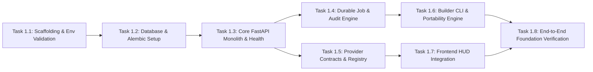

# SIMPLYYTR 2.0 — Phase 1 Foundation Engineering Plan

**Date:** 2026-10-09  
**Architect:** Antigravity (Lead Systems Architect & AI Agent Workflow Engineer)  
**Status:** PLAN PROPOSAL (Requires Phase 0 Review Approval)  
**Authority:** [docs/SIMPLYYTR_2_0_FINAL_COMPLETE_SYSTEM_SPECIFICATION.md](file:///D:/Projects/SIMPLYYTR/docs/SIMPLYYTR_2_0_FINAL_COMPLETE_SYSTEM_SPECIFICATION.md)  
**Prerequisites:** Completion of Phase 0 Forensic Audit  

---

## 1. Phase 1 Mission & Boundary

### 1.1 Objective
Phase 1 establishes the **minimal, robust, builder-portable vertical foundation** for SIMPLYYTR 2.0. It delivers a clean modular monolith backend (FastAPI), a normalized PostgreSQL + pgvector database layer, persistent background job lifecycle tracking, structured audit logging, provider abstraction contracts, and a refined Next.js dashboard shell.

### 1.2 Hard Boundaries (Explicitly Deferred)
To ensure Phase 1 remains focused, small, and achievable without architectural sprawl:
- **DEFERRED to Phase 2:** Distributed compute fabric, Kaggle GPU workers, and multi-node rendering queues.
- **DEFERRED to Phase 3:** Full AlphaSignal research pipeline, multi-source ingestion crawlers (Playwright/Crawl4AI), and topic scoring graphs.
- **DEFERRED to Phase 4:** Vector knowledge graph population and embedding index pipelines.
- **DEFERRED to Phase 5:** Script compilation, deep copywriting rubrics, and angle ranking.
- **DEFERRED to Phase 6:** Video rendering, FFmpeg Timeline IR composition, Kokoro TTS, and lip-sync avatars.
- **DEFERRED to Phase 7:** Affiliate API integrations and real-time product discovery.
- **DEFERRED to Phase 8:** Public YouTube video publishing and channel upload execution.
- **DEFERRED to Phase 9:** YouTube Analytics sync and postmortems.
- **DEFERRED to Phase 10-12:** Autonomous brain loops, multi-armed bandits, and production hardening.

---

## 2. Foundation Architecture & Module Boundaries

```mermaid
graph TD
    subgraph Frontend [apps/web (Next.js 16 + React 19)]
        UI[Modular HUD Shell]
        Nav[Workspace & Navigation]
        JobMonitor[Job & Health Monitor]
        AuditViewer[Audit Event Viewer]
    end

    subgraph Backend Core [apps/core (Python 3.11 + FastAPI)]
        API[FastAPI Gateway (/api/v1)]
        Config[Pydantic BaseSettings & Secret Ref Engine]
        JobEngine[Durable Job Engine]
        AuditEngine[Structured Audit Logger]
        ProviderRegistry[Provider Contract Registry]
    end

    subgraph Data Layer [PostgreSQL 16 + pgvector]
        DB[(PostgreSQL)]
        Alembic[Alembic Migrations]
    end

    subgraph Builder System [.agent/ & scripts/builder/]
        Portability[Builder State CLI & Manifest Engine]
    end

    UI -->|HTTP / JSON| API
    API --> Config
    API --> JobEngine
    API --> AuditEngine
    API --> ProviderRegistry
    JobEngine --> DB
    AuditEngine --> DB
    Alembic --> DB
    Portability --> BackendCore
```

### 2.1 Repository Layout for Phase 1
```text
SIMPLYYTR/
├── apps/
│   ├── core/                    # New FastAPI modular monolith (Backend)
│   │   ├── src/
│   │   │   ├── api/             # FastAPI routes (/health, /workspaces, /jobs, /audit, /providers)
│   │   │   ├── config/          # Pydantic Settings & environment validation
│   │   │   ├── db/              # SQLAlchemy 2.x async models & session factory
│   │   │   ├── migrations/      # Alembic migration revisions
│   │   │   ├── jobs/            # Persistent job state machine & runner
│   │   │   ├── audit/           # AuditEvent structured logging
│   │   │   ├── providers/       # Abstract provider contracts (LLM, Storage, TTS, Video)
│   │   │   └── main.py          # FastAPI application entrypoint
│   │   ├── tests/               # Pytest suite (unit & integration tests)
│   │   ├── pyproject.toml       # Poetry / pip requirements
│   │   └── Dockerfile           # Backend container definition
│   └── web/                     # Existing Next.js 16 UI (Refactored)
│       ├── src/
│       │   ├── app/             # App Router layout & modular tab components
│       │   ├── components/      # Reusable HUD cards, status badges, telemetry tables
│       │   └── lib/             # API client connecting to FastAPI backend
│       └── package.json
├── .agent/                      # Builder-portable engineering memory
├── .agents/skills/              # Portable skills
├── docs/                        # Authoritative documentation & ADRs
├── schemas/                     # Shared JSON / Task Contract schemas
└── scripts/
    └── builder/                 # builder status / doctor / checkpoint CLI
```

---

## 3. Initial Database Models (SQLAlchemy 2.x & Alembic)

Phase 1 establishes six core entities in PostgreSQL:

1. **`Workspace`**:
   - `id`: UUID (Primary Key)
   - `name`: String(100)
   - `slug`: String(100), Unique
   - `is_active`: Boolean, default=True
   - `created_at`: DateTime(timezone=True)
   - `updated_at`: DateTime(timezone=True)

2. **`Channel`**:
   - `id`: UUID (Primary Key)
   - `workspace_id`: UUID, ForeignKey(`Workspace.id`)
   - `name`: String(150)
   - `platform`: String(50), default="YOUTUBE"
   - `platform_channel_id`: String(100), Nullable
   - `encrypted_credentials`: Text, Nullable (Encrypted OAuth refresh token reference)
   - `created_at`: DateTime(timezone=True)

3. **`ProviderConfig`**:
   - `id`: UUID (Primary Key)
   - `workspace_id`: UUID, ForeignKey(`Workspace.id`)
   - `category`: Enum(`LLM`, `TTS`, `ASR`, `VISION`, `STORAGE`, `PUBLISHING`)
   - `provider_name`: String(100) (e.g., `ollama`, `vllm`, `groq`, `cloudflare_r2`, `local_disk`)
   - `is_enabled`: Boolean, default=True
   - `is_default`: Boolean, default=False
   - `settings`: JSONB (Non-sensitive config parameters, e.g. model name, context length)
   - `secret_ref`: String(100), Nullable (Name of the environment variable holding API key)

4. **`ModelProfile`**:
   - `id`: UUID (Primary Key)
   - `provider_id`: UUID, ForeignKey(`ProviderConfig.id`)
   - `model_name`: String(100) (e.g., `qwen2.5:7b-instruct`, `kokoro-82m`)
   - `context_window`: Integer, default=8192
   - `cost_per_million_input`: Float, default=0.0
   - `cost_per_million_output`: Float, default=0.0

5. **`BackgroundJob`**:
   - `id`: UUID (Primary Key)
   - `workspace_id`: UUID, ForeignKey(`Workspace.id`)
   - `job_type`: String(50) (e.g., `HEALTH_CHECK`, `PROVIDER_VERIFY`, `SAMPLE_INFERENCE`)
   - `status`: Enum(`PENDING`, `RUNNING`, `COMPLETED`, `FAILED`, `CANCELLED`)
   - `payload`: JSONB (Job parameters)
   - `result`: JSONB, Nullable (Job output data)
   - `progress_percent`: Integer, default=0
   - `attempts`: Integer, default=0
   - `max_attempts`: Integer, default=3
   - `error_message`: Text, Nullable
   - `created_at`: DateTime(timezone=True)
   - `started_at`: DateTime(timezone=True), Nullable
   - `completed_at`: DateTime(timezone=True), Nullable

6. **`AuditEvent`**:
   - `id`: UUID (Primary Key)
   - `workspace_id`: UUID, ForeignKey(`Workspace.id`)
   - `job_id`: UUID, ForeignKey(`BackgroundJob.id`), Nullable
   - `action`: String(100) (e.g., `PROVIDER_REGISTERED`, `JOB_STARTED`, `CHECKPOINT_SAVED`)
   - `actor`: String(100) (e.g., `system`, `user`, `builder_antigravity`)
   - `details`: JSONB (Structured metadata; NEVER contains secrets)
   - `ip_address`: String(45), Nullable
   - `created_at`: DateTime(timezone=True)

---

## 4. Provider Contracts Architecture

SIMPLYYTR separates domain intent (**WHAT**) from execution mechanics (**HOW**). In Phase 1, we implement strict abstract base classes in Python:

```python
from abc import ABC, abstractmethod
from typing import Dict, Any, Optional
from pydantic import BaseModel

class CompletionRequest(BaseModel):
    prompt: str
    model: str
    temperature: float = 0.7
    max_tokens: int = 1024
    json_mode: bool = False

class CompletionResponse(BaseModel):
    content: str
    model: str
    prompt_tokens: int = 0
    completion_tokens: int = 0
    latency_ms: float

class LLMProvider(ABC):
    @abstractmethod
    async def complete(self, request: CompletionRequest) -> CompletionResponse:
        pass

    @abstractmethod
    async def health(self) -> bool:
        pass
```

Implementations in Phase 1:
- `MockLLMProvider` (Always available for zero-cost, hermetic CI tests)
- `OllamaProvider` (Local-first, calls `http://localhost:11434`)
- `GroqProvider` (Optional cloud adapter via environment variable)

---

## 5. Builder Portability CLI & Commands

Phase 1 formalizes the builder command interface using Python Click / Typer in `scripts/builder/`:

1. `simplyytr builder status`: Outputs active branch, commit, phase, current task, pending subtasks, and last test run.
2. `simplyytr builder doctor`: Verifies Python runtime, PostgreSQL connectivity, Docker daemon, and environment sanity.
3. `simplyytr builder checkpoint`: Updates `.agent/state/CURRENT_STATE.md`, records git hash, and exports `.agent/transfer/transfer_manifest.json`.
4. `simplyytr builder export --target <builder>`: Prepares target-specific instructions (`.agent/adapters/`) and bundles transfer metadata.
5. `simplyytr builder verify-transfer`: Validates transfer manifest integrity against JSON schema.

---

## 6. Phase 1 Task Breakdown & Dependencies



| Task ID | Title | Scope & Allowed Paths | Preconditions | Acceptance Tests |
|---|---|---|---|---|
| **T-1.1** | Repository Scaffolding & Hygiene | Clean up duplicates (`kaggle_logs`, `simplyytr-updateed`, `ytdownlod`); configure root `.gitignore` to scrub Chrome profiles | Phase 0 audit approved | `git status` clean; `.gitignore` blocks all sensitive profiles |
| **T-1.2** | Database & Alembic Setup | Create `apps/core/src/db/` models; create Alembic migration script; test with PostgreSQL | PostgreSQL running | Migrations run up and rollback cleanly |
| **T-1.3** | FastAPI Modular Monolith | Scaffold FastAPI in `apps/core`; implement `/health` and `/api/v1/workspaces` | T-1.2 complete | `pytest tests/test_health.py` passes (HTTP 200) |
| **T-1.4** | Durable Job & Audit Engine | Implement `BackgroundJob` state machine and `AuditEvent` logging in `apps/core/src/jobs` | T-1.3 complete | Submitting job progresses `PENDING` -> `RUNNING` -> `COMPLETED`; audit row created |
| **T-1.5** | Provider Contracts & Mock Adapter | Implement `LLMProvider`, `StorageProvider`, and `MockLLMProvider` | T-1.3 complete | Unit tests verify provider interface and health checks |
| **T-1.6** | Builder Portability CLI | Implement Python CLI `simplyytr builder status/doctor/checkpoint` | T-1.1 complete | Manifest generates with valid schema; no secrets present |
| **T-1.7** | Frontend HUD Integration | Connect Next.js 16 UI shell to FastAPI `/api/v1` endpoints; render real health & jobs | T-1.3, T-1.4 complete | Dashboard displays real PostgreSQL connection status and active jobs |
| **T-1.8** | End-to-End Foundation Verification | Full developer walkthrough test script | All tasks complete | Developer walkthrough passes from clean clone to checkpoint export |

---

## 7. Acceptance Criteria & Exit Verification

Phase 1 is complete when all of the following criteria are verified by automated tests:
1. **Fresh Clone Bootstrapping:** A developer can clone the repository, run `docker compose up -d postgres`, and start the backend without manual file edits.
2. **Database Integrity:** Alembic migrations apply cleanly and create all 6 core tables with zero warnings.
3. **API Readiness:** `GET /health` returns `{ "status": "ok", "database": "connected", "version": "2.0.0" }`.
4. **Job Lifecycle:** A test job can be dispatched, polled, completed, and verified in the database with progress tracking.
5. **Audit Trail:** An `AuditEvent` is persisted for every job transition and configuration change.
6. **Zero Secrets in Git:** Git status confirms no `.env`, token, or Chrome profile files are tracked.
7. **Builder Portability:** Running `simplyytr builder checkpoint` outputs a valid, schema-compliant transfer manifest with current Git commit, branch, and test outcomes.
