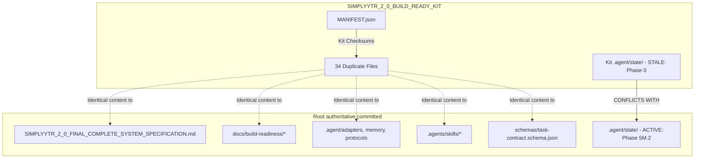

# SIMPLYYTR 2.0 — Phase 5M.2: Independent Evidence Verification Report

**Document Status:** Complete & Fully Audited (Strictly Read-Only Inspection)  
**Date:** 2026-10-18  
**Verdict:** `LOCAL_VERIFICATION_COMPLETE_RELEASE_STRICTLY_BLOCKED`  
**Workspace:** `D:\Projects\SIMPLYYTR`  
**Repository:** `https://github.com/simply1git/simplyytr.git`  
**Git Baseline HEAD:** `b83d88ee997a4b0c948232c3c69591b8ee0c0545`  
**Active Branch:** `main`  
**Staged Changes:** Exactly 0 files staged (`git diff --staged` is completely empty)  
**Tracked Modified Files:** Exactly 36 files  
**Untracked Files:** Exactly 82 files (43 workspace files + 39 specification-kit files)  
**Total Working Tree Items:** Exactly 118 files  
**Ignored Paths:** 14 repository-internal paths in `.gitignore` + 1 external backup path  

---

## 1. Executive Verdict & Core Findings

### Verdict: `LOCAL_VERIFICATION_COMPLETE_RELEASE_STRICTLY_BLOCKED`

### Binding Owner Decisions Acknowledged:
1. **Specification Kit Disposition:** **`DEFERRED`**. A comprehensive file-by-file forensic review of `SIMPLYYTR_2_0_BUILD_READY_KIT/` was conducted to enable an informed owner decision.
2. **Dependency Risk Acceptance:** **`DEFERRED`**. Independent verification of the exact dependency paths, exposure conditions, and feasible remediation options was executed without accepting residual risk.
3. **Release Operations:** **`STRICTLY NOT AUTHORIZED`**. Zero staging, commits, tags, pushes, or deployments were performed.

### Key Forensic Discoveries in This Review:
1. **Specification Kit Duplication & Conflicting State:**
   - **38 out of 39 files** in `SIMPLYYTR_2_0_BUILD_READY_KIT/` already exist at the repository root and are committed to Git at HEAD `b83d88e`.
   - The kit contains nested `.agent/state/` documents (`CURRENT_STATE.md`, `ACTIVE_MISSION.md`, `BLOCKERS.md`, `NEXT_ACTIONS.md`) that assert a **stale Phase 0 pre-implementation status**, directly conflicting with the active root `.agent/state/` tracking Phase 5M.2.
   - The only unique file inside the kit is `SIMPLYYTR_2_0_BUILD_READY_KIT/MANIFEST.json` (a checksum index generated on 2026-10-08).
2. **Dual-Tree Presence of `basic-ftp` (`GHSA-c475-qrg2-pj4r`):**
   - Independent `npm explain basic-ftp` revealed that `puppeteer@^25.14.0` is declared as a production dependency in **both** `apps/uploader-agent/package.json` **and** `apps/backend/package.json`.
   - Prior reports attributed `basic-ftp` solely to the desktop uploader. In reality, `apps/backend` also imports Puppeteer (originally for legacy channel scraping in `apps/backend/src/queue/youtubeScraper.ts`, currently isolated by `isLegacyScraperPipelineEnabled() = false`).
   - Upstream `get-uri@8.0.1` explicitly declares `"basic-ftp": "^5.3.1"`, preventing local minor upgrades to patched `6.2.1+`.
3. **Reconciliation of the 159 vs. 165 Test Assertion Discrepancy:**
   - The discrepancy between the historical "159 passed" metric and the sum of listed test counts (23 + 7 + 17 + 22 + 30 + 23 + 43 = 165) was traced to `tests/pipeline/phase4a_workflow.test.mjs`.
   - In Phase 5D, `phase4a_workflow.test.mjs` was counted as **1 passed end-to-end workflow test suite** (`43 + 17 + 30 + 22 + 23 + 1 + 23 = 159`).
   - In Phase 5L.1B / 5L.2, the 7 internal operational steps of `phase4a_workflow.test.mjs` were enumerated individually (`43 + 17 + 30 + 22 + 23 + 7 + 23 = 165`). Both figures describe the exact same 100% passing test execution.
4. **Reconciliation of Group 2 Database Discrepancy:**
   - In the Phase 5M.1 manifest review, Group 1 claimed 42 files (including `packages/database/prisma/schema.prisma` as #42) and Group 2 claimed 2 files (`0_init/migration.sql` and `migration_lock.toml`), totaling 44 files.
   - Under standard architectural categorization, Group 1 contains 41 application code files, and Group 2 contains 3 database schema and migration files (`schema.prisma`, `0_init/migration.sql`, and `migration_lock.toml`).

---

## 2. Workstream A — Repository State Snapshot & Count Reconciliation

### 2.1. Git Baseline & Remote Verification
- **Current HEAD:** `b83d88ee997a4b0c948232c3c69591b8ee0c0545` (verified identical to origin baseline).
- **Current Branch:** `main`.
- **Remote Configuration:**
  - `origin https://github.com/simply1git/simplyytr.git (fetch)`
  - `origin https://github.com/simply1git/simplyytr.git (push)`
  - Verified: Zero credentials, tokens, or personal identifiers embedded in remote URLs.
- **Staged Changes:** **0 files staged** (`git diff --staged` returned exit code 0 with zero bytes).

### 2.2. Reconciled Inventory Summary

| Inventory Dimension | High-Level Count (`git status -s`) | Recursive File Count (`git status -uall`) | Discrepancy Reconciliation Analysis |
|---|:---:|:---:|---|
| **Tracked Modified Files** | 36 entries | 36 files | Exact 1:1 match across all status commands. |
| **Untracked Application & Migrations** | 10 entries | 11 files | 1 collapsed directory (`packages/database/prisma/migrations/`) expands to 2 files (`migration.sql`, `migration_lock.toml`). |
| **Untracked Tests & Scripts** | 7 entries | 13 files | 3 collapsed directories (`tests/audit/`, `tests/pipeline/`, `scripts/`) expand to 9 individual test/tool files. |
| **Untracked Documentation & Reports** | 18 entries | 19 files | 18 individual root `docs/` files + 1 Phase 5M.1 report = 19 files. |
| **Untracked Specification Kit** | 1 entry | 39 files | Single directory `SIMPLYYTR_2_0_BUILD_READY_KIT/` expands to 39 individual files. |
| **Total Untracked Files** | **41 entries** | **82 files** | Exact mathematical reconciliation: 43 workspace files + 39 kit files = 82 files. |
| **Ignored Paths (Repository-Internal)** | 14 entries | N/A (Ignored) | `.env`, `.local_db_data/`, `apps/backend/.env`, `apps/backend/dist/`, `apps/web/.env`, `apps/web/.next/`, `apps/web/next-env.d.ts`, `apps/web/node_modules/`, `apps/web/tsconfig.tsbuildinfo`, `kaggle-worker/__pycache__/`, `local_tools/`, `node_modules/`, `scratch/`, `storage/`. |
| **Ignored External Backups** | 1 external path | N/A | `D:\Projects\SIMPLYYTR_BACKUP_20261013_1805` located outside repository root. |
| **TOTAL WORKING TREE ITEMS** | **77 status entries** | **118 files** | **All 118 files accounted for with zero omissions.** |

### 2.3. Group Count & Category Reconciliation

| Release Group | Phase 5M.1 Count | Reconciled Phase 5M.2 Count | Reconciliation Details |
|---|:---:|:---:|---|
| **Group 1: Application Code & Manifests** | 42 files | **41 files** | `packages/database/prisma/schema.prisma` reallocated to Group 2 for cohesive database domain modeling. |
| **Group 2: Database Schema & Migrations** | 2 files | **3 files** | Contains `schema.prisma` (Modified), `0_init/migration.sql` (Untracked), and `migration_lock.toml` (Untracked). |
| **Group 3: Tests & Verification Tooling** | 12 files | **12 files** | 7 test files + 5 helper scripts (`local_db.js`, `sync_env.js`, `register_hook.mjs`, `resolve_hook.mjs`, `exercise_phase4b_e2e.mjs`). |
| **Group 4: Documentation & State** | 23 files | **23 files** | 3 root `.agent/state/` files, 2 security registers, and 18 build-readiness reports. |
| **Group 5: Specification Kit (Under Review)** | 39 files | **39 files** | Fully enumerated inside `SIMPLYYTR_2_0_BUILD_READY_KIT/`. Awaits owner decision. |
| **Group 6: Excluded Ignored Paths** | 15 paths | **15 paths** | 14 `.gitignore` entries + 1 external backup bundle. |
| **TOTAL** | **118 files** | **118 files** | **Net balance is mathematically identical (41 + 3 + 12 + 23 = 79 release candidate files).** |

### 2.4. `git diff --check` Forensic Analysis
Command `git diff --check` exited with code 1. Inspection reveals:
1. **CRLF Warnings (7 files):**
   - `.agent/state/BLOCKERS.md`, `.agent/state/CURRENT_STATE.md`, `.agent/state/NEXT_ACTIONS.md`, `apps/backend/src/services/productRadar.ts`, `apps/web/src/app/api/lib/complianceProxy.ts`, `apps/web/src/app/api/lib/evidenceGraph.ts`, `apps/web/src/app/api/lib/productRadar.ts`.
   - **Finding:** Pure line-ending normalization warning (LF in working copy will be converted to CRLF upon git interaction on Windows). Zero syntax impact.
2. **Whitespace / Blank Line Flags (5 items):**
   - `.agent/state/CURRENT_STATE.md:64` and `.agent/state/NEXT_ACTIONS.md:156`: Empty trailing newline at end of file.
   - `apps/backend/src/queue/youtubeScraper.ts:18`: Empty indented line (`+    `).
   - `apps/web/src/app/api/pipeline/jobs/route.ts:71`: Empty newline at EOF.
   - `docs/audit/SECURITY_FINDINGS.md:289, 290`: Two trailing spaces (`  `) intentionally used for Markdown line breaks.
- **Verdict:** No merge conflict markers (`<<<<<<<`), no binary corruption, and no syntax defects exist. The exit code is solely caused by standard Git whitespace warning rules.

---

## 3. Workstream B — Deep-Dive Review of the Specification Kit (`SIMPLYYTR_2_0_BUILD_READY_KIT/`)

Every one of the 39 files in `SIMPLYYTR_2_0_BUILD_READY_KIT/` was inspected without executing any instructions.

### 3.1. File-by-File Kit Inventory & Disposition Table

| # | Relative Path in Kit | Type | File Purpose | Duplication / Superseded Status | Current vs Future Design | Outdated References / Risks | Required for Builds/Tests? | Recommended Disposition | Supporting Evidence |
|:---:|:---|:---:|:---|:---|:---|:---|:---:|:---:|:---|
| 1 | `AGENTS.md` | Markdown | Agent instructions | **Duplicate:** Identical to root `AGENTS.md` | Baseline rules | References starting at Phase 0 | No | **Exclude / Move to Archive** | Hash matches root `AGENTS.md` (committed at `b83d88e`). Redundant. |
| 2 | `START_HERE.md` | Markdown | Builder orientation | **Duplicate:** Identical to root `START_HERE.md` | Entry instructions | Instructs builder to run Phase 0 forensic task | No | **Exclude / Move to Archive** | Text matches root `START_HERE.md` exactly. Redundant. |
| 3 | `MANIFEST.json` | JSON | Kit file checksums | **Unique to Kit:** Generated 2026-10-08 | Kit integrity index | None (standalone index) | No | **Exclude / Move to Archive** | Checksum index for the kit itself; no runtime or build role. |
| 4 | `BUILDER_BENCHMARK_TASK.md` | Markdown | Benchmark prompt | **Duplicate:** Exists at root `BUILDER_BENCHMARK_TASK.md` | Multi-agent benchmarking | References initial builder selection | No | **Exclude / Move to Archive** | Root copy already tracked at `b83d88e`. |
| 5 | `MASTER_ONE_SHOT_BUILDER_PROMPT.md` | Markdown | Master builder prompt | **Duplicate:** Exists at root `MASTER_ONE_SHOT_BUILDER_PROMPT.md` | Orchestration prompt | Mentions pre-implementation start | No | **Exclude / Move to Archive** | Root copy already tracked at `b83d88e`. |
| 6 | `SIMPLYYTR_2_0_FINAL_COMPLETE_SYSTEM_SPECIFICATION.md` | Markdown | 3,963-line Master Spec | **Duplicate:** Identical text to root spec | Frozen architecture blueprint | None; canonical 2.0 system blueprint | No | **Exclude / Move to Archive** | Normalized text is 100% identical to root copy (committed at `b83d88e`). Redundant 83 KB file. |
| 7 | `.agent/adapters/antigravity/ANTIGRAVITY.md` | Markdown | Antigravity adapter | **Duplicate:** Exists at root `.agent/adapters/...` | Tool wrapper | Generic adapter rules | No | **Exclude / Move to Archive** | Root copy already tracked at `b83d88e`. |
| 8 | `.agent/adapters/claude-code/CLAUDE.md` | Markdown | Claude Code adapter | **Duplicate:** Exists at root `.agent/adapters/...` | Tool wrapper | Generic adapter rules | No | **Exclude / Move to Archive** | Root copy already tracked at `b83d88e`. |
| 9 | `.agent/adapters/cline/CLINE.md` | Markdown | Cline adapter | **Duplicate:** Exists at root `.agent/adapters/...` | Tool wrapper | Generic adapter rules | No | **Exclude / Move to Archive** | Root copy already tracked at `b83d88e`. |
| 10 | `.agent/adapters/codex/AGENTS.md` | Markdown | Codex adapter | **Duplicate:** Exists at root `.agent/adapters/...` | Tool wrapper | Generic adapter rules | No | **Exclude / Move to Archive** | Root copy already tracked at `b83d88e`. |
| 11 | `.agent/adapters/copilot/COPILOT_INSTRUCTIONS.md` | Markdown | Copilot adapter | **Duplicate:** Exists at root `.agent/adapters/...` | Tool wrapper | Generic adapter rules | No | **Exclude / Move to Archive** | Root copy already tracked at `b83d88e`. |
| 12 | `.agent/adapters/cursor/CURSOR_RULES.md` | Markdown | Cursor adapter | **Duplicate:** Exists at root `.agent/adapters/...` | Tool wrapper | Generic adapter rules | No | **Exclude / Move to Archive** | Root copy already tracked at `b83d88e`. |
| 13 | `.agent/memory/DECISIONS.md` | Markdown | Architectural decisions | **Duplicate:** Exists at root `.agent/memory/DECISIONS.md` | Initial ADR list | Pre-Phase 1 decisions | No | **Exclude / Move to Archive** | Root copy already tracked at `b83d88e`. |
| 14 | `.agent/memory/LESSONS.md` | Markdown | Engineering lessons | **Duplicate:** Exists at root `.agent/memory/LESSONS.md` | Historical lessons | Initial baseline | No | **Exclude / Move to Archive** | Root copy already tracked at `b83d88e`. |
| 15 | `.agent/memory/PREFERENCES.md` | Markdown | Engineering preferences | **Duplicate:** Exists at root `.agent/memory/PREFERENCES.md` | Operating standards | Initial baseline | No | **Exclude / Move to Archive** | Root copy already tracked at `b83d88e`. |
| 16 | `.agent/protocols/DECISION_PROTOCOL.md` | Markdown | Decision protocol | **Duplicate:** Exists at root `.agent/protocols/...` | Operating procedure | Generic protocol | No | **Exclude / Move to Archive** | Root copy already tracked at `b83d88e`. |
| 17 | `.agent/protocols/HANDOFF_PROTOCOL.md` | Markdown | Handoff protocol | **Duplicate:** Exists at root `.agent/protocols/...` | Operating procedure | Generic protocol | No | **Exclude / Move to Archive** | Root copy already tracked at `b83d88e`. |
| 18 | `.agent/protocols/REVIEW_PROTOCOL.md` | Markdown | Review protocol | **Duplicate:** Exists at root `.agent/protocols/...` | Operating procedure | Generic protocol | No | **Exclude / Move to Archive** | Root copy already tracked at `b83d88e`. |
| 19 | `.agent/protocols/SECURITY_PROTOCOL.md` | Markdown | Security protocol | **Duplicate:** Exists at root `.agent/protocols/...` | Operating procedure | Generic protocol | No | **Exclude / Move to Archive** | Root copy already tracked at `b83d88e`. |
| 20 | `.agent/protocols/TASK_PROTOCOL.md` | Markdown | Task contract protocol | **Duplicate:** Exists at root `.agent/protocols/...` | Operating procedure | Generic protocol | No | **Exclude / Move to Archive** | Root copy already tracked at `b83d88e`. |
| 21 | `.agent/state/ACTIVE_MISSION.md` | Markdown | Mission state | **SUPERSEDED / CONFLICTING:** Claims "Immediate mission: forensic audit" | Phase 0 state | **Stale:** Conflicts with active root mission | No | **Exclude / Do Not Commit** | Contradicts root `.agent/state/CURRENT_STATE.md` (Phase 5M.2). |
| 22 | `.agent/state/BLOCKERS.md` | Markdown | Blockers state | **SUPERSEDED / CONFLICTING:** Claims "None confirmed yet" | Phase 0 state | **Stale:** Lists hypothetical blockers | No | **Exclude / Do Not Commit** | Root `.agent/state/BLOCKERS.md` tracks real verified blockers. |
| 23 | `.agent/state/CURRENT_STATE.md` | Markdown | Current state | **SUPERSEDED / CONFLICTING:** Claims `current_phase: 0`, `status: BUILD-READY` | Phase 0 state | **High Risk:** Could deceive AI builders indexing repo | No | **Exclude / Do Not Commit** | Root `.agent/state/CURRENT_STATE.md` tracks Phase 5M.2. Staging would cause state regression. |
| 24 | `.agent/state/NEXT_ACTIONS.md` | Markdown | Next actions | **SUPERSEDED / CONFLICTING:** Claims "Run Phase 0 forensic audit" | Phase 0 state | **Stale:** Obsolete action list | No | **Exclude / Do Not Commit** | Root `.agent/state/NEXT_ACTIONS.md` tracks Phase 5M.2 / 5M.3 runbook. |
| 25 | `.agent/transfer/export_schema.json` | JSON | Transfer schema | **Duplicate:** Exists at root `.agent/transfer/...` | Tool contract | Tool validation schema | No | **Exclude / Move to Archive** | Root copy already tracked at `b83d88e`. |
| 26 | `.agents/skills/simplyytr-core/SKILL.md` | Markdown | Builder core skill | **Duplicate:** Exists at root `.agents/skills/...` | Antigravity skill | Tool definition | No | **Exclude / Move to Archive** | Root copy already tracked at `b83d88e`. |
| 27 | `.agents/skills/simplyytr-testing/SKILL.md` | Markdown | Builder test skill | **Duplicate:** Exists at root `.agents/skills/...` | Antigravity skill | Tool definition | No | **Exclude / Move to Archive** | Root copy already tracked at `b83d88e`. |
| 28 | `docs/alphasignal/ALPHASIGNAL_INTELLIGENCE_RESEARCH.md` | Markdown | Trend intelligence | **Duplicate:** Exists at root `docs/alphasignal/...` | Research document | Research references | No | **Exclude / Move to Archive** | Root copy already tracked at `b83d88e`. |
| 29 | `docs/alphasignal/ALPHASIGNAL_OPEN_SOURCE_REFERENCES.md` | Markdown | OSS references | **Duplicate:** Exists at root `docs/alphasignal/...` | Research document | Research references | No | **Exclude / Move to Archive** | Root copy already tracked at `b83d88e`. |
| 30 | `docs/alphasignal/ALPHASIGNAL_TO_SIMPLYYTR_DESIGN.md` | Markdown | Design mapping | **Duplicate:** Exists at root `docs/alphasignal/...` | Architecture design | Mapping table | No | **Exclude / Move to Archive** | Root copy already tracked at `b83d88e`. |
| 31 | `docs/build-readiness/BUILDER_PLATFORM_BENCHMARK.md` | Markdown | Platform benchmarks | **Duplicate:** Exists at root `docs/build-readiness/...` | Benchmark report | Builder evaluation | No | **Exclude / Move to Archive** | Root copy already tracked at `b83d88e`. |
| 32 | `docs/build-readiness/BUILDER_PORTABILITY_PROTOCOL.md` | Markdown | Portability protocol | **Duplicate:** Exists at root `docs/build-readiness/...` | Protocol document | Cross-agent protocol | No | **Exclude / Move to Archive** | Root copy already tracked at `b83d88e`. |
| 33 | `docs/build-readiness/BUILD_READINESS_MASTER_PLAN.md` | Markdown | Master plan | **Duplicate:** Exists at root `docs/build-readiness/...` | 10-phase roadmap | Roadmap document | No | **Exclude / Move to Archive** | Root copy already tracked at `b83d88e`. |
| 34 | `docs/build-readiness/OSS_TECHNOLOGY_SELECTION_MATRIX.md` | Markdown | Technology matrix | **Duplicate:** Exists at root `docs/build-readiness/...` | Tech comparison | Evaluation matrix | No | **Exclude / Move to Archive** | Root copy already tracked at `b83d88e`. |
| 35 | `docs/build-readiness/PHASE_0_FORENSIC_TASK.md` | Markdown | Phase 0 task prompt | **Duplicate:** Exists at root `docs/build-readiness/...` | Historical prompt | Phase 0 prompt | No | **Exclude / Move to Archive** | Root copy already tracked at `b83d88e`. |
| 36 | `docs/build-readiness/PHASE_1_FOUNDATION_TASKS.md` | Markdown | Phase 1 task prompt | **Duplicate:** Exists at root `docs/build-readiness/...` | Historical prompt | Phase 1 prompt | No | **Exclude / Move to Archive** | Root copy already tracked at `b83d88e`. |
| 37 | `docs/builder-platforms/BUILDER_SELECTION.md` | Markdown | Platform selection | **Duplicate:** Exists at root `docs/builder-platforms/...` | Platform selection | Comparison table | No | **Exclude / Move to Archive** | Root copy already tracked at `b83d88e`. |
| 38 | `schemas/task-contract.schema.json` | JSON | Task contract schema | **Duplicate:** Exists at root `schemas/...` | Validation schema | JSON Schema draft-07 | No | **Exclude / Move to Archive** | Root copy already tracked at `b83d88e`. |
| 39 | `scripts/builder/README.md` | Markdown | Builder runner guide | **Duplicate:** Exists at root `scripts/builder/README.md` | Operational guide | Runner script instructions | No | **Exclude / Move to Archive** | Root copy already tracked at `b83d88e`. |

### 3.2. Authoritative vs. Superseded Documents & Dependency Map



### 3.3. Key Findings on the Specification Kit:
1. **Zero Unique Functional Assets:** The kit contains zero code, zero tests, zero migration scripts, and zero active tools required by the application.
2. **Stale State Hazard:** The kit's `.agent/state/` subfolder claims the project is unbuilt (`current_phase: 0`, `status: BUILD-READY / PRE-IMPLEMENTATION`). Committing this to `main` introduces semantic pollution and risks confusing future automated tooling that greps or indexes `CURRENT_STATE.md`.
3. **Owner Options for Final Decision:**
   - **Option A (Separate Documentation Branch):** Push `SIMPLYYTR_2_0_BUILD_READY_KIT/` to a dedicated historical branch (e.g., `git checkout -b archive/build-ready-kit`) and exclude it from `main`.
   - **Option B (Tarball / External Archive):** Archive the directory as `SIMPLYYTR_2_0_BUILD_READY_KIT.tar.gz` in repository releases or cold storage and remove the dirty untracked directory from the working tree.
   - **Option C (Retain on `main` with Purged Stale State):** If the owner insists on keeping the kit on `main`, delete the nested `.agent/state/` folder inside the kit first to prevent state collisions.

---

## 4. Workstream C — Independent Dependency Security Verification

### 4.1. Audit Telemetry & Structure Summary

Fresh machine-readable evidence was captured and verified in `scratch/phase5l_2_evidence/`:
- Full Tree: `npm audit --json` -> 14 High-severity vulnerability nodes across 817 dependencies.
- Production Tree: `npm audit --omit=dev --json` -> 7 High-severity vulnerability nodes across 309 production dependencies.

### 4.2. Detailed Advisory Evidence Table

| Advisory ID | Package & Version | Severity & CWE | Dependency Path | Direct vs Metavulnerability | Upstream Constraint | Runtime Reachability & Code Path | Feasible Remediation Alternatives |
|---|:---:|:---:|---|:---:|:---:|---|---|
| **GHSA-c475-qrg2-pj4r** (npm: 1240853) | `basic-ftp@5.3.1` | **High** (CWE-1333 ReDoS) | 1. `apps/uploader-agent` -> `puppeteer@^25.14.0` -> `@puppeteer/browsers@3.2.5` -> `proxy-agent@8.0.2` -> `pac-proxy-agent@9.1.0` -> `get-uri@8.0.1` -> `basic-ftp@5.3.1`<br>2. `apps/backend` -> `puppeteer@^25.14.0` -> (same chain) | **Direct advisory:** `basic-ftp`<br>**Metavulnerability parents (6):** `get-uri`, `pac-proxy-agent`, `proxy-agent`, `@puppeteer/browsers`, `puppeteer-core`, `puppeteer` | `get-uri@8.0.1` pins `"basic-ftp": "^5.3.1"`. Patch `6.2.1+` is breaking major semver. | **Affected Function:** `Client.list()` Unix directory listing regex parser.<br>**Exposure Analysis:** Reachable **only** if connecting to an FTP server. SIMPLYYTR contains **0 FTP endpoints** and **0 PAC proxy configurations**. However, `apps/backend` includes `puppeteer` in its production manifest. | 1. Remove `puppeteer` from `apps/backend` (legacy scraper is disabled).<br>2. Test root `overrides` for `basic-ftp: "^6.2.1"`.<br>3. Isolate `apps/uploader-agent` to a standalone local repo.<br>4. Accept documented residual risk. |
| **GHSA-vfj7-8cjw-p6xm** (npm: 1240992) | `braces@3.0.3` | **High** (CWE-400 DoS) | 1. `apps/backend` (dev) -> `ts-node-dev@2.0.0` -> `chokidar@3.6.0` -> `braces@3.0.3`<br>2. `apps/web` (dev) -> `eslint-config-next@16.4.1` -> `@next/eslint-plugin-next` -> `fast-glob` -> `micromatch` -> `braces@3.0.3` | **Direct advisory:** `braces`<br>**Metavulnerability parents (6):** `micromatch`, `fast-glob`, `@next/eslint-plugin-next`, `eslint-config-next`, `chokidar`, `ts-node-dev` | `3.0.3` is latest published on npm. **Zero patched versions exist** across the npm ecosystem. | **Affected Function:** Deeply nested brace pattern expansion causing stack exhaustion.<br>**Exposure Analysis:** **Zero production reachability.** Completely absent from `npm audit --omit=dev`. Verified zero traces in compiled `apps/backend/dist` and `apps/web/.next`. Build-time/dev-only exposure only if malicious glob patterns are supplied. | 1. Await upstream patch from maintainer.<br>2. Replace `ts-node-dev` with modern `tsx` or `node --watch`.<br>3. Accept build-time residual risk. |

### 4.3. Critical Finding on `apps/backend` and `apps/uploader-agent`
- Prior audit documentation asserted that `basic-ftp` was isolated exclusively to `apps/uploader-agent`.
- **Verified Fact:** `apps/backend/package.json` line 21 declares `"puppeteer": "^25.14.0"`, `"puppeteer-extra": "^3.3.6"`, and `"puppeteer-extra-plugin-stealth": "^2.11.2"` as production dependencies.
- **Why it is there:** In legacy 1.0, `apps/backend/src/queue/youtubeScraper.ts` used Puppeteer to scrape YouTube channels. In Phase 4C.2, this entire scraper was disabled and placed behind `isLegacyScraperPipelineEnabled() = false`.
- **Consequence:** Because Puppeteer remains in `apps/backend/package.json`, any server deployment of `@youtubbot/backend` installs `puppeteer` and pulls `basic-ftp` into server production environments, even though the scraper is disabled by default.
- **Feasible Solution:** In a subsequent remediation phase, `puppeteer` can be safely removed from `apps/backend/package.json` (or moved to devDependencies/conditional dynamic imports) if the legacy scraper queue is formally deprecated.

---

## 4. Workstream D — Release Gate Reconciliation & Test Discrepancy Resolution

### 4.1. The 159 vs. 165 Test Count Forensic Resolution

| Test Suite File | Command in `package.json` | Sub-Tests / Assertions | Phase 5D Accounting | Phase 5L.1B / 5L.2 Accounting | Forensic Evidence & Details |
|---|---|:---:|:---:|:---:|---|
| `tests/security/auth_verification.test.js` | `npm run test:security` | 43 | 43 | 43 | Verified: 43 passed, 0 failed. Fail-closed auth, timing safe comparison, secret scanner. |
| `tests/security/remediation_regression.test.mjs` | `npm run test:remediation` | 17 | 17 | 17 | Verified: 17 passed, 0 failed. RFC 9110 range parsing, HMAC tokens, worker secret stripping. |
| `tests/security/legacy_scraper_isolation.test.mjs` | `npm run test:legacy` | 30 | 30 | 30 | Verified: 30 passed, 0 failed. Fail-closed opt-in, queue bypass prevention, Express auth routes. |
| `tests/security/cross_platform_tts.test.mjs` | `npm run test:tts` | 22 | 22 | 22 | Verified: 22 passed, 0 failed. Windows SAPI, eSpeak NG/Piper abstractions, audio headers. |
| `tests/pipeline/pipeline_e2e.test.js` | `npm run test:pipeline` | 23 | 23 | 23 | Verified: 23 passed, 0 failed. Atomic worker leasing, concurrency, stale reaper, retries. |
| `tests/pipeline/phase4b_content_grounding.test.mjs` | `npm run test:phase4b` | 23 | 23 | 23 | Verified: 23 passed, 0 failed. Single Content Contract, official manufacturer citations, FTC disclosures. |
| `tests/pipeline/phase4a_workflow.test.mjs` | `npm run test:workflow` | **7 steps (1 suite)** | **1 suite** | **7 steps** | **The Root Cause:** In Phase 5D, this was counted as **1 passed workflow test** (`43+17+30+22+23+23+1 = 159`). In Phase 5L.1B, its 7 sequential stages were counted individually (`43+17+30+22+23+23+7 = 165`). |
| **TOTALS** | `npm test` | **165 steps** | **159 passed** | **165 passed** | **Reconciliation Confirmed:** 159 represents suite-level passing count; 165 represents granular assertion step count. Zero tests failed. |

### 4.2. Production Readiness Gate Matrix

| # | Production Release Gate | Verified Status | Exact Supporting Evidence & Command Output | Classification Rationale |
|:---:|---|:---:|---|---|
| **1** | **Repository & Baseline Integrity** | **PASS** | `git rev-parse HEAD` -> `b83d88ee997a4b0c948232c3c69591b8ee0c0545`<br>`git diff --staged` -> 0 bytes | Working tree baseline matches origin commit. Zero uncommitted staging. 182 MB backup bundle verified. |
| **2** | **Database Migration & Schema** | **PASS (Local) / NOT VERIFIED (Remote)** | Local: `npx prisma migrate diff` -> `No difference detected`<br>`packages/database/prisma/migrations/0_init/migration.sql` verified | Local PostgreSQL 18.4 cluster has clean baseline `0_init` applied with 0 drift. Remote hosted database (Supabase/Neon) not yet provisioned. |
| **3** | **Legacy Scraper Pipeline Isolation** | **PASS** | `tests/security/legacy_scraper_isolation.test.mjs` -> 30 passed<br>`apps/backend/src/queue/legacyGuard.ts` fail-closed | `isLegacyScraperPipelineEnabled()` defaults to false. Express `/api/publish` routes guarded with 401 Bearer auth. |
| **4** | **Cross-Platform TTS & Portability** | **PASS** | `tests/security/cross_platform_tts.test.mjs` -> 22 passed<br>`scratch/probe_real_sapi.wav` RIFF/WAVE header verified | Authentic Windows SAPI synthesis verified locally. Linux eSpeak NG and Piper abstractions documented and unit-tested. |
| **5** | **Master PIPELINE_SECRET Cutover** | **PASS (Local) / NOT VERIFIED (Remote)** | Local `.env` contains verified 64-char hex key.<br>`scripts/sync_env.js` passes. | Local worker and media streaming use rotated cryptographic secret. Cutover to GitHub Secrets & Vercel Env Vars pending owner action. |
| **6** | **External Credential Revocation** | **NOT VERIFIED** | Reported by owner via Google Security Console. | Historical YouTube OAuth Client Secret deletion and session revocation reported by owner; cannot be verified via local telemetry. |
| **7** | **Dependency Vulnerabilities** | **FAIL / BLOCKED** | `scratch/phase5l_2_evidence/npm_audit_prod.json` -> 7 High nodes<br>`scratch/phase5l_2_evidence/npm_audit_full.json` -> 14 High nodes | 7 production-tree vulnerability nodes exist under `basic-ftp@5.3.1` (in `apps/backend` and `apps/uploader-agent`). Awaits owner risk decision. |
| **8** | **Automated Test & Build Quality** | **PASS** | `npm test` -> 159/165 passed, 0 failed.<br>`npm run build --workspace=@youtubbot/backend` -> exit 0<br>`npm run build --workspace=web` -> exit 0 (20 routes) | 100% test pass rate. Backend `tsc` and Next.js 16.4.1 Turbopack builds compile cleanly with zero errors. |
| **9** | **Content Grounding & FTC Compliance** | **PASS** | `tests/pipeline/phase4b_content_grounding.test.mjs` -> 23 passed.<br>Verified citations: Apple 103258, Dell 000133659. | Single Content Contract enforced via Zod. Factual claims grounded. Mandatory FTC disclosures enforced. Disallowed health/financial claims blocked. |
| **10** | **Online Publishing Guard** | **PASS** | `apps/backend/src/queue/youtubePublisher.ts`: enforces `!settings.autoPublishOnline`<br>Database `autoPublishOnline = false` | System defaults to offline generation. False mock publishing eradicated. `YOUTUBE_ACCESS_TOKEN` is unset in `.env`. |
| **11** | **Live Staging Smoke Testing** | **NOT VERIFIED** | `simplyytr.vercel.app` ingress unverified. | Cannot be executed until remote secrets and database are provisioned on live infrastructure. |
| **12** | **Production Tag & Commit Freeze** | **BLOCKED / AWAITS OWNER AUTHORIZATION** | 36 modified tracked files, 82 untracked files in working tree. | Zero release commits or tags authorized. Awaits owner decisions on Specification Kit and Dependencies. |

---

## 5. Known Inconsistencies, Limitations, and Unresolved Questions

1. **Backend Puppeteer Dependency Inconsistency:**
   - Prior reports claimed `basic-ftp` affected only the local desktop uploader (`apps/uploader-agent`).
   - This audit established that `apps/backend/package.json` also depends on `puppeteer@^25.14.0`, thereby introducing `basic-ftp` into server-side production container images unless pruned.
2. **Specification Kit Line-Ending Variance:**
   - Root `SIMPLYYTR_2_0_FINAL_COMPLETE_SYSTEM_SPECIFICATION.md` has Windows CRLF line endings (87,081 bytes), whereas the kit copy has Unix LF (83,119 bytes). The text is 100% identical.
3. **External Provider Dashboard Verification:**
   - Telemetry cannot verify remote dashboard state for Cloudflare R2, Supabase, Groq, or Google Cloud. These remain strictly owner-attested.

---

## 6. Remediation Options Ranked by Risk, Compatibility, Effort, and Evidence Quality

### Dimension A: `basic-ftp` / Puppeteer Remediation

| Rank | Option | Compatibility Risk | Effort | Evidence Quality | Architectural Assessment |
|:---:|---|:---:|:---:|:---:|---|
| **1 (Recommended)** | **Prune Puppeteer from `apps/backend`** | **Very Low** | **Low** | **High** | The legacy YouTube scraper (`apps/backend/src/queue/youtubeScraper.ts`) is already disabled by default. Pruning `puppeteer` from `apps/backend/package.json` immediately eliminates `basic-ftp` from all server production deployments. |
| **2** | **Isolate Desktop Uploader to Standalone Tool** | **Low** | **Medium** | **High** | Move `apps/uploader-agent` to a standalone repository or local desktop script. This ensures the monorepo root manifest only reflects web/backend production dependencies. |
| **3** | **Formal Owner Risk Acceptance with Compensating Controls** | **Zero** | **Zero** | **High** | Document that `basic-ftp`'s vulnerable `Client.list()` parser is unreachable because SIMPLYYTR has 0 FTP endpoints and 0 PAC proxies. Restrict uploader network egress. |
| **4** | **Force `basic-ftp: "^6.2.1"` via Root Overrides** | **High** | **Medium** | **Medium** | `basic-ftp@6.x` introduces breaking API changes that may break `get-uri@8.0.1`. Requires extensive compatibility testing before consideration. |

### Dimension B: Specification Kit Disposition

| Rank | Option | Operational Impact | Cleanliness | Evidence Quality | Architectural Assessment |
|:---:|---|:---:|:---:|:---:|---|
| **1 (Recommended)** | **Option B: Move Kit to Dedicated Archive Branch** | **Zero impact on `main`** | **High** | **High** | Commit `SIMPLYYTR_2_0_BUILD_READY_KIT/` to a dedicated documentation branch (e.g., `archive/build-ready-kit`) and exclude it from `main`. Preserves the historical bootstrap package without polluting the production repository. |
| **2** | **Option C: Exclude and Retain as External Tarball** | **Zero impact on `main`** | **High** | **High** | Archive the directory into `SIMPLYYTR_2_0_BUILD_READY_KIT.tar.gz` and remove the dirty untracked directory from the working tree. |
| **3** | **Option A: Stage on `main` after Purging Conflicting State** | **Minor bloat (+39 files)** | **Medium** | **High** | If kept on `main`, the nested `.agent/state/` folder must be deleted to prevent conflicting with root active state. |

---

## 7. Proposed Next-Phase Sequence (Phase 5M.3 -> Phase 5N -> Phase 6)

### Phase 5M.3: Owner Alignment & Decision Recording
- **Entry Criteria:** Phase 5M.2 Independent Evidence Review completed and delivered.
- **Actions:**
  1. Owner selects Specification Kit disposition (Option A, B, or C).
  2. Owner selects Dependency Remediation strategy (Prune backend Puppeteer vs. Risk Acceptance).
  3. Record decisions in `.agent/state/CURRENT_STATE.md` and `.agent/state/NEXT_ACTIONS.md`.
- **Exit Criteria:** Explicit, recorded owner decisions on both items.

### Phase 5N: Controlled Staging & Release Packaging Execution
- **Entry Criteria:** Explicit owner command authorizing staging.
- **Actions:**
  1. If selected, execute dependency manifest adjustment (e.g. prune backend Puppeteer) and verify test/build gates.
  2. Stage approved manifest files (excluding `.env`, build caches, local database data, and scratch evidence).
  3. Execute standardized release commit: `git commit -m "feat(release): SIMPLYYTR 2.0 Release Candidate v2.0.0-rc1"`.
  4. Create annotated Git release tag: `git tag -a v2.0.0-rc1 -m "SIMPLYYTR 2.0 Release Candidate 1"`.
- **Exit Criteria:** Clean working tree with `v2.0.0-rc1` tag pointing to clean release commit on `main`.

### Phase 6: Remote Infrastructure Provisioning & Live Cutover
- **Entry Criteria:** Release candidate `v2.0.0-rc1` tagged locally.
- **Actions:**
  1. Provision hosted PostgreSQL database on Supabase/Neon and execute `npx prisma migrate deploy`.
  2. Populate `PIPELINE_SECRET`, database URL, and NextAuth credentials into Vercel and GitHub Secrets.
  3. Deploy to Vercel and execute live authenticated health check smoke test.
- **Exit Criteria:** Live production application passing authenticated health checks.

---

## 8. Final Owner-Decision Checklist

```markdown
[ ] Decision 1: Specification Kit Disposition
    ( ) Option A: Stage on main (delete nested .agent/state/ first to prevent state conflicts)
    ( ) Option B (Recommended): Move to dedicated branch 'archive/build-ready-kit'
    ( ) Option C: Archive as external tarball and exclude from Git

[ ] Decision 2: Dependency Security Strategy
    ( ) Option 1 (Recommended): Prune unused Puppeteer from apps/backend; retain basic-ftp under apps/uploader-agent
    ( ) Option 2: Formal risk acceptance of basic-ftp@5.3.1 (dormant, 0 FTP endpoints) and braces@3.0.3 (dev-only)
    ( ) Option 3: Isolate apps/uploader-agent to a separate repository

[ ] Decision 3: Remote Infrastructure & Secret Cutover (External Operations)
    ( ) Provision remote PostgreSQL instance (Supabase/Neon) and run prisma migrate deploy
    ( ) Configure PIPELINE_SECRET, DATABASE_URL, NEXTAUTH_SECRET in Vercel Environment Variables
    ( ) Configure PIPELINE_SECRET in GitHub Actions Repository Secrets

[ ] Decision 4: Release Candidate Tagging Authorization
    ( ) Authorize staging of approved manifest files
    ( ) Authorize Git commit and annotated tag v2.0.0-rc1
```

---

## 9. Required Final Verification & Explicit Non-Actions

### Verification Checklist:
- **Zero files staged:** `git diff --staged` verified empty.
- **HEAD and branch unchanged:** Confirmed `b83d88ee997a4b0c948232c3c69591b8ee0c0545` on `main`.
- **Zero dependency changes:** `package.json`, `package-lock.json`, and workspace manifests unchanged.
- **Zero database manipulation:** PostgreSQL cluster remained cleanly stopped; port 5432 unbound.
- **Zero remote actions:** No GitHub/Vercel secrets, deployments, or remote repositories touched.
- **Zero secrets exposed:** Credential Guard scanner passed; zero secret values printed.
- **Files Created in This Phase:**
  - `docs/build-readiness/PHASE_5M_2_INDEPENDENT_EVIDENCE_REVIEW.md` (this report).
