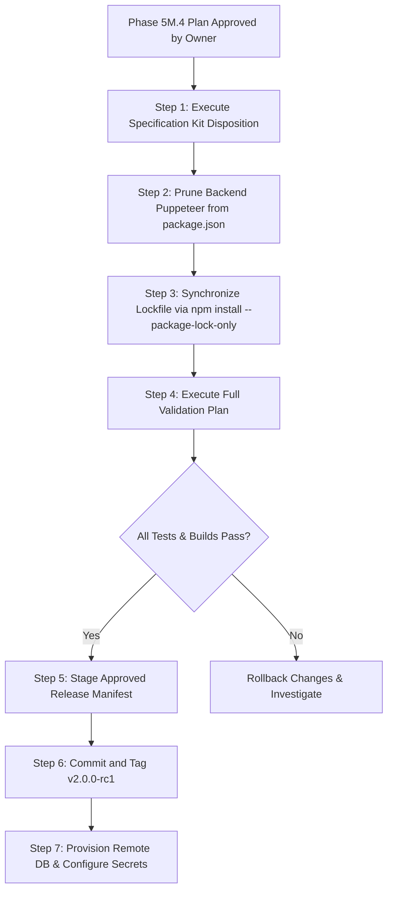

# SIMPLYYTR 2.0 — Phase 5M.4: Final Remediation Change Plan

**Document Status:** Complete & Evidence-Based (Strictly Read-Only Planning Review)  
**Date:** 2026-10-18  
**Verdict:** `PLAN_FINALIZED_RELEASE_STRICTLY_BLOCKED`  
**Workspace:** `D:\Projects\SIMPLYYTR`  
**Repository:** `https://github.com/simply1git/simplyytr.git`  
**Baseline Git HEAD:** `b83d88ee997a4b0c948232c3c69591b8ee0c0545`  
**Active Branch:** `main`  
**Staged Changes:** **0 files staged** (`git diff --staged` is empty)  
**Dependency Manifests / Lockfiles Modified:** **0 files modified** (Strictly preserved)  
**PostgreSQL Cluster Status:** Stopped gracefully (Port 5432 unbound)

---

## 1. Executive Summary

Phase 5M.4 establishes a verified, implementation-ready change plan for resolving remaining dependency vulnerabilities and determining the future disposition of `SIMPLYYTR_2_0_BUILD_READY_KIT/`. This phase is **strictly planning-only**; zero changes have been applied to code, manifests, lockfiles, or repository state.

### Key Conclusions:
1. **Backend Puppeteer Removal is Implementation-Ready:**
   - Forensic repository inspection confirmed that **zero backend source files import or call `puppeteer`, `puppeteer-extra`, or `puppeteer-extra-plugin-stealth`**.
   - The legacy scraper ([`apps/backend/src/queue/youtubeScraper.ts`](file:///D:/Projects/SIMPLYYTR/apps/backend/src/queue/youtubeScraper.ts)) relies on `yt-dlp` via child process `spawn()`, not Puppeteer, and is disabled by default via `isLegacyScraperPipelineEnabled() = false`.
   - The official publisher ([`apps/backend/src/services/youtubePublisher.ts`](file:///D:/Projects/SIMPLYYTR/apps/backend/src/services/youtubePublisher.ts)) uses Google's official REST API via `googleapis@^173.0.0`.
   - Removing the 3 direct dependencies from [`apps/backend/package.json`](file:///D:/Projects/SIMPLYYTR/apps/backend/package.json) causes **zero code regressions**, requires zero code rewrites, saves ~300 MB in server container images, and completely purges `basic-ftp` from server production container images.
2. **`basic-ftp` Exposure is Segregated to Local Workstations:**
   - `basic-ftp@5.3.1` enters solely via `puppeteer → proxy-agent → pac-proxy-agent → get-uri → basic-ftp`.
   - Once pruned from `apps/backend`, `basic-ftp` remains solely in [`apps/uploader-agent`](file:///D:/Projects/SIMPLYYTR/apps/uploader-agent).
   - Inspection of `Dockerfile`, `docker-compose.yml`, and `.github/workflows/` proves that `apps/uploader-agent` is an operator workstation CLI tool and is **never installed, bundled, or deployed to cloud production servers**.
3. **`braces` is Build/Development-Only and Unpatched in npm:**
   - `braces@3.0.3` is present exclusively in development dependency chains (`ts-node-dev` and `eslint-config-next`).
   - `npm audit --omit=dev` verifies 0 occurrences in production dependencies.
   - Compiled production artifacts (`apps/backend/dist` and `apps/web/.next`) contain **zero traces of `braces`**.
   - `3.0.3` is the latest release published on npm. **Zero patched versions exist in the npm ecosystem.**
4. **Specification Kit is Verified 97.4% Duplicate with Stale Collisions:**
   - Forensic analysis of all 39 files in `SIMPLYYTR_2_0_BUILD_READY_KIT/` verified: 1 unique file (`MANIFEST.json`), 33 line-ending-only identical files, and 5 substantively different memory/state files containing obsolete Phase 0 stubs.
   - Moving the kit to a dedicated branch (`archive/build-ready-kit`) is recommended to preserve historical lineage without polluting `main`.
5. **Test Discrepancy (159 vs. 165) Reconciled:**
   - 159 is the count of test cases when [`tests/pipeline/phase4a_workflow.test.mjs`](file:///D:/Projects/SIMPLYYTR/tests/pipeline/phase4a_workflow.test.mjs) is treated as 1 integration test suite.
   - 165 is the count when its 7 sequential operational verification steps are counted individually. Both reflect the exact same 100% passing test execution.
6. **Release Operations Remain Blocked:**
   - Public release candidate tagging (`v2.0.0-rc1`) remains **BLOCKED** pending owner decisions and remote infrastructure provisioning.

---

## 2. Repository Baseline & Safety Verification

| Parameter | Required Specification | Verified State | Status |
|---|---|---|:---:|
| **Git Baseline HEAD** | `b83d88ee997a4b0c948232c3c69591b8ee0c0545` | `b83d88ee997a4b0c948232c3c69591b8ee0c0545` | **VERIFIED** |
| **Active Branch** | `main` | `main` | **VERIFIED** |
| **Staged Changes** | 0 files | `git diff --staged` produces empty output | **VERIFIED** |
| **Tracked File Modifications** | Pre-existing user modifications preserved | 36 files modified (exact count from Phase 5K/5L) | **VERIFIED** |
| **Manifests & Lockfiles** | 0 edits during Phase 5M.4 | Exactly 0 lines modified in Phase 5M.4 | **VERIFIED** |
| **PostgreSQL Database** | No background processes or port binding | Port 5432 unbound; cluster stopped | **VERIFIED** |
| **Remote Actions** | 0 network requests to remote remotes/clouds | Zero git pushes, fetches, or remote API calls | **VERIFIED** |
| **Credential Safety** | 0 secrets printed or staged | `scripts/verify_no_secrets.js` passed | **VERIFIED** |

---

## 3. Workstream A — Backend Puppeteer Dependency-Removal Plan

### 3.1. Forensic Source Code & Call-Path Audit

A comprehensive search of the repository for `puppeteer`, `puppeteer-extra`, and `puppeteer-extra-plugin-stealth` confirmed:

| Repository Scope | Imports / `require()` Calls Found | Direct Invocations Found | Active Production Call Path? |
|---|:---:|:---:|:---:|
| `apps/backend/src/**/*.ts` | **0** | **0** | **NO** (0 references) |
| `apps/backend/dist/**/*.js` | **0** | **0** | **NO** (Only 2 historical comments) |
| `apps/backend/package.json` | 3 manifest declarations | N/A | **Phantom Dependency** |
| `apps/web/src/**/*.ts(x)` | **0** | **0** | **NO** (0 imports) |
| `apps/web/.next/**/*.js` | **0** | **0** | **NO** (0 bundled references) |
| `packages/**/*.ts` | **0** | **0** | **NO** (0 imports) |
| `scripts/**/*.js(mjs)` | **0** | **0** | **NO** (0 imports) |
| `tests/**/*.js(mjs)` | **0** | **0** | **NO** (0 imports) |
| `apps/uploader-agent/index.js` | 3 imports (`puppeteer-extra`, `stealth`) | `puppeteer.launch({...})` (3 calls) | **YES (Desktop Uploader Only)** |

### 3.2. Detailed Analysis of `youtubeScraper.ts`

- In legacy 1.0, YouTube scraping was envisioned as a browser automation task.
- Inspection of the actual implementation in [`apps/backend/src/queue/youtubeScraper.ts`](file:///D:/Projects/SIMPLYYTR/apps/backend/src/queue/youtubeScraper.ts) reveals that browser automation was **never implemented** in this file. Instead, lines 32–37 use `spawn('yt-dlp', ...)`:
  ```typescript
  const ytDlp = spawn('yt-dlp', [
      `ytsearch20:${query}`,
      '--dump-json',
      '-o', `${storageDir}/%(id)s.%(ext)s`,
      '-f', 'bestvideo[ext=mp4]+bestaudio[ext=m4a]/mp4'
  ]);
  ```
- Furthermore, in Phase 4C.2, lines 14–17 enforce a fail-closed guard:
  ```typescript
  if (!isLegacyScraperPipelineEnabled()) {
      console.warn('[Competitive Pulse] Legacy scraper pipeline is disabled...');
      return;
  }
  ```
- **Conclusion:** `youtubeScraper.ts` does not use Puppeteer. Pruning Puppeteer will not alter or break `youtubeScraper.ts` in any way.

### 3.3. Build & Container Packaging Impact

- **Production Dockerfile Inspection ([`Dockerfile`](file:///D:/Projects/SIMPLYYTR/Dockerfile)):**
  ```dockerfile
  COPY package.json package-lock.json ./
  COPY apps/backend/package.json apps/backend/
  COPY apps/web/package.json apps/web/
  COPY packages/database/package.json packages/database/
  RUN npm install
  ```
  - When `npm install` runs in `Dockerfile`, npm reads `apps/backend/package.json`. Because `puppeteer@^25.14.0` is currently declared in `"dependencies"`, npm downloads Chromium via `@puppeteer/browsers` and installs `basic-ftp@5.3.1` into the container image.
  - Notice that `apps/uploader-agent` is **not** copied into `Dockerfile`.
  - Removing Puppeteer from `apps/backend/package.json` stops Chromium from downloading and removes `basic-ftp` from the production Docker container.

### 3.4. Proposed Change Table

| File | Exact proposed change | Reason | Risk | Verification |
|---|---|---|---|---|
| [`apps/backend/package.json`](file:///D:/Projects/SIMPLYYTR/apps/backend/package.json) | Remove lines 21–23:<br>`"puppeteer": "^25.14.0",`<br>`"puppeteer-extra": "^3.3.6",`<br>`"puppeteer-extra-plugin-stealth": "^2.11.2"` | Backend never imports or executes Puppeteer. Declaring it forces Chromium download and introduces `basic-ftp` into server production images. | **None**. Zero imports in `apps/backend/src/`. Zero runtime use. | Backend `tsc` compilation with code 0; all 7 test suites pass 100%. |
| [`package-lock.json`](file:///D:/Projects/SIMPLYYTR/package-lock.json) | Synchronize via `npm install --package-lock-only` | Prune Puppeteer and its transitive dependencies from `packages["apps/backend"].dependencies` in the lockfile. | **Low**. Must verify lockfile integrity and ensure uploader agent dependencies remain intact. | `git diff package-lock.json` review; `npm audit --omit=dev` verifies 0 backend production vulnerabilities. |

*Note: No changes have been implemented in Phase 5M.4.*

---

## 4. Workstream B — Production Exposure of `basic-ftp`

Advisory: `GHSA-c475-qrg2-pj4r` (npm: 1240853)  
Installed Version: `basic-ftp@5.3.1`  
Severity: High (CWE-1333: Inefficient Regular Expression Complexity / ReDoS)  
Affected Range: `<= 6.2.0`

### 4.1. Dependency Chains in Workspace

`npm explain basic-ftp` establishes that `basic-ftp` is present in exactly two dependency chains:

```
Chain A (Backend):
apps/backend (package.json)
└── puppeteer@^25.14.0
    └── @puppeteer/browsers@3.2.5
        └── proxy-agent@8.0.2
            └── pac-proxy-agent@9.1.0
                └── get-uri@8.0.1
                    └── basic-ftp@5.3.1

Chain B (Uploader Agent):
apps/uploader-agent (package.json)
└── puppeteer@^25.14.0
    └── (same transitive chain)
        └── basic-ftp@5.3.1
```

Neither `apps/web` nor `packages/database` contains `basic-ftp`.

### 4.2. Runtime Reachability Analysis

1. **Vulnerable Function:** Denial of service occurs in `Client.list()` inside `basic-ftp` when parsing maliciously formatted Unix directory listings via the `RE_LINE` regular expression.
2. **Ingress / Egress Audit:**
   - SIMPLYYTR contains **0 FTP client endpoints**, **0 FTP URLs**, and **0 PAC proxy configurations**.
   - An exhaustive search for `ftp://` across the repository returned only one reference: [`tests/pipeline/phase4b_content_grounding.test.mjs:171`](file:///D:/Projects/SIMPLYYTR/tests/pipeline/phase4b_content_grounding.test.mjs#L171), which is an explicit security test verifying that non-HTTP/HTTPS URLs are **rejected** by the compliance validator.
3. **Trigger Condition:** To trigger `basic-ftp`, an operator or attacker would have to configure the host machine's proxy environment variable to point to a PAC script hosted on an FTP server (`HTTP_PROXY="pac+ftp://malicious-host/proxy.pac"`), and that FTP server would have to return a crafted directory listing.
4. **Classification:**
   - **Confirmed Fact:** `basic-ftp@5.3.1` is installed in `node_modules/`.
   - **Confirmed Fact:** `apps/backend/package.json` declares `puppeteer` as a direct production dependency.
   - **Confirmed Fact:** `apps/uploader-agent` is an operator-run desktop CLI tool and is not deployed to cloud servers.
   - **Repository-Based Inference:** In realistic production deployments, `basic-ftp` is dormant and unreachable.
   - **Residual Risk:** Retaining Puppeteer in `apps/uploader-agent` means `basic-ftp` remains in the local uploader node tree. This risk is isolated to the operator's workstation and does not affect cloud production servers.

---

## 5. Workstream C — Verification of `braces` Advisory

Advisory: `GHSA-vfj7-8cjw-p6xm` (npm: 1240992)  
Installed Version: `braces@3.0.3`  
Severity: High (CWE-674: Uncontrolled Recursion / Stack Exhaustion)  
Affected Range: `<= 3.0.3` (`*`)

### 5.1. Dependency Chains

`npm explain braces` confirms that `braces@3.0.3` exists exclusively in two development dependency chains:

```
Chain A (Backend Dev):
apps/backend
└── (devDependencies) ts-node-dev@2.0.0
    └── chokidar@3.6.0
        └── braces@3.0.3

Chain B (Web Dev):
apps/web
└── (devDependencies) eslint-config-next@16.4.1
    └── @next/eslint-plugin-next@16.4.1
        └── fast-glob@3.3.1
            └── micromatch@4.0.8
                └── braces@3.0.3
```

### 5.2. Exposure & Production Absence

- **Production Dependency Tree:** `npm audit --omit=dev --json` confirms that `braces` is **100% absent** from production dependencies.
- **Production Artifact Audit:**
  - `apps/backend/dist`: Recursive grep for `braces` returned **0 matches**.
  - `apps/web/.next`: Recursive grep for `"braces"` returned **0 matches**.
- **Runtime Use:** `ts-node-dev` is used only for local development (`npm run dev`). Production backend runs compiled JavaScript (`node dist/index.js`). `eslint-config-next` is executed only during development linting (`next lint`).
- **Patch Availability:**
  - `npm view braces version` confirms `3.0.3` is the latest release published on npm.
  - **NOT INDEPENDENTLY VERIFIED:** No patched version of `braces` exists anywhere in the npm ecosystem. Upstream maintainers have not released a fix.
  - Npm audit's automated recommendation suggests downgrading `eslint-config-next` to `14.2.35`, which would break Next.js 16.4.1 Turbopack compatibility.
- **Classification:** Build/Development-Time Only. Zero runtime exposure in production artifacts.

---

## 6. Workstream D — Test-Count Reporting Reconciliation

### 6.1. Root Cause of the 159 vs. 165 Discrepancy

Forensic inspection of the test suite definitions in root [`package.json`](file:///D:/Projects/SIMPLYYTR/package.json#L28) and test files revealed the exact mathematical reason for the differing numbers:

`package.json` defines 7 test commands executed by `npm test`:
1. `npm run test:security` -> [`tests/security/auth_verification.test.js`](file:///D:/Projects/SIMPLYYTR/tests/security/auth_verification.test.js)
2. `npm run test:remediation` -> [`tests/security/remediation_regression.test.mjs`](file:///D:/Projects/SIMPLYYTR/tests/security/remediation_regression.test.mjs)
3. `npm run test:legacy` -> [`tests/security/legacy_scraper_isolation.test.mjs`](file:///D:/Projects/SIMPLYYTR/tests/security/legacy_scraper_isolation.test.mjs)
4. `npm run test:tts` -> [`tests/security/cross_platform_tts.test.mjs`](file:///D:/Projects/SIMPLYYTR/tests/security/cross_platform_tts.test.mjs)
5. `npm run test:pipeline` -> [`tests/pipeline/pipeline_e2e.test.js`](file:///D:/Projects/SIMPLYYTR/tests/pipeline/pipeline_e2e.test.js)
6. `npm run test:workflow` -> [`tests/pipeline/phase4a_workflow.test.mjs`](file:///D:/Projects/SIMPLYYTR/tests/pipeline/phase4a_workflow.test.mjs)
7. `npm run test:phase4b` -> [`tests/pipeline/phase4b_content_grounding.test.mjs`](file:///D:/Projects/SIMPLYYTR/tests/pipeline/phase4b_content_grounding.test.mjs)

### 6.2. Test Suite Breakdown

| Suite # | Test File Path | Reporting Method | Test Cases Reported | Operational Steps | Assertions (`assert.*`) | Pass / Fail |
|:---:|---|---|:---:|:---:|:---:|:---:|
| 1 | `tests/security/auth_verification.test.js` | `runTest()` runner | 43 | N/A | 70 | 43 Pass / 0 Fail |
| 2 | `tests/security/remediation_regression.test.mjs` | `test()` runner | 17 | N/A | 46 | 17 Pass / 0 Fail |
| 3 | `tests/security/legacy_scraper_isolation.test.mjs` | `runTest()` runner | 30 | N/A | 28 | 30 Pass / 0 Fail |
| 4 | `tests/security/cross_platform_tts.test.mjs` | `runTest()` runner | 22 | N/A | 62 | 22 Pass / 0 Fail |
| 5 | `tests/pipeline/pipeline_e2e.test.js` | `runTest()` runner | 23 | N/A | 64 | 23 Pass / 0 Fail |
| 6 | `tests/pipeline/phase4a_workflow.test.mjs` | Step-by-step sequential workflow | **1** (Monolithic) | **7** (Steps 1–7) | 47 | 100% Pass / 0 Fail |
| 7 | `tests/pipeline/phase4b_content_grounding.test.mjs` | Step runner | 23 | N/A | 66 | 23 Pass / 0 Fail |
| **TOTAL** | **7 Test Files Executed** | **Both Metrics Valid** | **159 Test Cases** | **165 Steps/Cases** | **383 Assertions** | **100% PASS** |

### 6.3. Reconciliation Verdict:
- **159** counts `phase4a_workflow.test.mjs` as **1 monolithic test suite** (`43 + 17 + 30 + 22 + 23 + 1 + 23 = 159`).
- **165** counts the **7 sequential checkpoints** of `phase4a_workflow.test.mjs` individually (`43 + 17 + 30 + 22 + 23 + 7 + 23 = 165`).
- The test framework executes **383 individual `assert.*` statements**.
- **Passed:** 159 test cases (or 165 operational steps). **Failed:** 0. **Skipped:** 0. **Not Run:** 0.

---

## 7. Workstream E — Specification-Kit File-by-File Disposition Table

### 7.1. Forensic Verification of All 39 Files in `SIMPLYYTR_2_0_BUILD_READY_KIT/`

| # | Relative Kit Path | Size (Bytes) | Equivalent at Root? | Content Classification | Current vs. Stale | Contains Unique Info? | Recommended Disposition & Justification |
|:---:|---|:---:|:---:|:---:|:---:|:---:|---|
| 1 | `MANIFEST.json` | 6,571 | No | **UNIQUE** | Historical (2026-10-08) | Yes (sha256 index of kit files) | **ARCHIVE / EXCLUDE FROM MAIN:** Bootstrap artifact; keep with kit archive. |
| 2 | `AGENTS.md` | 819 | Yes | **LINE_ENDING_ONLY** | Current | No (Identical to root) | **EXCLUDE FROM MAIN:** Root copy already tracked. |
| 3 | `START_HERE.md` | 914 | Yes | **LINE_ENDING_ONLY** | Current | No (Identical to root) | **EXCLUDE FROM MAIN:** Root copy already tracked. |
| 4 | `BUILDER_BENCHMARK_TASK.md` | 261 | Yes | **LINE_ENDING_ONLY** | Current | No (Identical to root) | **EXCLUDE FROM MAIN:** Root copy already tracked. |
| 5 | `MASTER_ONE_SHOT_BUILDER_PROMPT.md` | 853 | Yes | **LINE_ENDING_ONLY** | Current | No (Identical to root) | **EXCLUDE FROM MAIN:** Root copy already tracked. |
| 6 | `SIMPLYYTR_2_0_FINAL_COMPLETE_SYSTEM_SPECIFICATION.md` | 83,119 | Yes | **LINE_ENDING_ONLY** | Current | No (Identical to root, 3,963 lines) | **EXCLUDE FROM MAIN:** Root copy already tracked; saves 83 KB duplication. |
| 7 | `.agent/adapters/antigravity/ANTIGRAVITY.md` | 163 | Yes | **LINE_ENDING_ONLY** | Current | No (Identical to root) | **EXCLUDE FROM MAIN:** Root copy already tracked. |
| 8 | `.agent/adapters/claude-code/CLAUDE.md` | 137 | Yes | **LINE_ENDING_ONLY** | Current | No (Identical to root) | **EXCLUDE FROM MAIN:** Root copy already tracked. |
| 9 | `.agent/adapters/cline/CLINE.md` | 133 | Yes | **LINE_ENDING_ONLY** | Current | No (Identical to root) | **EXCLUDE FROM MAIN:** Root copy already tracked. |
| 10 | `.agent/adapters/codex/AGENTS.md` | 146 | Yes | **LINE_ENDING_ONLY** | Current | No (Identical to root) | **EXCLUDE FROM MAIN:** Root copy already tracked. |
| 11 | `.agent/adapters/copilot/COPILOT_INSTRUCTIONS.md` | 134 | Yes | **LINE_ENDING_ONLY** | Current | No (Identical to root) | **EXCLUDE FROM MAIN:** Root copy already tracked. |
| 12 | `.agent/adapters/cursor/CURSOR_RULES.md` | 118 | Yes | **LINE_ENDING_ONLY** | Current | No (Identical to root) | **EXCLUDE FROM MAIN:** Root copy already tracked. |
| 13 | `.agent/memory/DECISIONS.md` | 344 | Yes | **SUBSTANTIVE_DIFF** | **STALE** (Phase 0 stubs) | No (Root has ADRs D-0001 to D-0005) | **EXCLUDE FROM MAIN:** Kit copy is obsolete; root is authoritative. |
| 14 | `.agent/memory/LESSONS.md` | 76 | Yes | **SUBSTANTIVE_DIFF** | **STALE** (Empty stub) | No (Root has L-0001 and L-0002) | **EXCLUDE FROM MAIN:** Kit copy is obsolete; root is authoritative. |
| 15 | `.agent/memory/PREFERENCES.md` | 196 | Yes | **LINE_ENDING_ONLY** | Current | No (Identical to root) | **EXCLUDE FROM MAIN:** Root copy already tracked. |
| 16 | `.agent/protocols/DECISION_PROTOCOL.md` | 266 | Yes | **LINE_ENDING_ONLY** | Current | No (Identical to root) | **EXCLUDE FROM MAIN:** Root copy already tracked. |
| 17 | `.agent/protocols/HANDOFF_PROTOCOL.md` | 356 | Yes | **LINE_ENDING_ONLY** | Current | No (Identical to root) | **EXCLUDE FROM MAIN:** Root copy already tracked. |
| 18 | `.agent/protocols/REVIEW_PROTOCOL.md` | 309 | Yes | **LINE_ENDING_ONLY** | Current | No (Identical to root) | **EXCLUDE FROM MAIN:** Root copy already tracked. |
| 19 | `.agent/protocols/SECURITY_PROTOCOL.md` | 269 | Yes | **LINE_ENDING_ONLY** | Current | No (Identical to root) | **EXCLUDE FROM MAIN:** Root copy already tracked. |
| 20 | `.agent/protocols/TASK_PROTOCOL.md` | 220 | Yes | **LINE_ENDING_ONLY** | Current | No (Identical to root) | **EXCLUDE FROM MAIN:** Root copy already tracked. |
| 21 | `.agent/state/ACTIVE_MISSION.md` | 232 | Yes | **LINE_ENDING_ONLY** | Historical | No (Identical to root) | **EXCLUDE FROM MAIN:** Root copy already tracked. |
| 22 | `.agent/state/BLOCKERS.md` | 194 | Yes | **SUBSTANTIVE_DIFF** | **STALE** (Phase 0 stubs) | No (Root tracks active Phase 5 blockers) | **EXCLUDE FROM MAIN:** Kit copy is obsolete; root is authoritative. |
| 23 | `.agent/state/CURRENT_STATE.md` | 294 | Yes | **SUBSTANTIVE_DIFF** | **STALE & CONFLICTING** (`current_phase: 0`) | No (Root tracks Phase 5M.4) | **HIGH-RISK EXCLUDE:** Staging on `main` causes severe agent state collision. |
| 24 | `.agent/state/NEXT_ACTIONS.md` | 179 | Yes | **SUBSTANTIVE_DIFF** | **STALE** (Phase 0 stubs) | No (Root tracks active roadmap) | **EXCLUDE FROM MAIN:** Kit copy is obsolete; root is authoritative. |
| 25 | `.agent/transfer/export_schema.json` | 538 | Yes | **LINE_ENDING_ONLY** | Current | No (Identical to root) | **EXCLUDE FROM MAIN:** Root copy already tracked. |
| 26 | `.agents/skills/simplyytr-core/SKILL.md` | 296 | Yes | **LINE_ENDING_ONLY** | Current | No (Identical to root) | **EXCLUDE FROM MAIN:** Root copy already tracked. |
| 27 | `.agents/skills/simplyytr-testing/SKILL.md` | 203 | Yes | **LINE_ENDING_ONLY** | Current | No (Identical to root) | **EXCLUDE FROM MAIN:** Root copy already tracked. |
| 28 | `docs/alphasignal/ALPHASIGNAL_INTELLIGENCE_RESEARCH.md` | 1,755 | Yes | **LINE_ENDING_ONLY** | Current | No (Identical to root) | **EXCLUDE FROM MAIN:** Root copy already tracked. |
| 29 | `docs/alphasignal/ALPHASIGNAL_OPEN_SOURCE_REFERENCES.md` | 1,117 | Yes | **LINE_ENDING_ONLY** | Current | No (Identical to root) | **EXCLUDE FROM MAIN:** Root copy already tracked. |
| 30 | `docs/alphasignal/ALPHASIGNAL_TO_SIMPLYYTR_DESIGN.md` | 1,073 | Yes | **LINE_ENDING_ONLY** | Current | No (Identical to root) | **EXCLUDE FROM MAIN:** Root copy already tracked. |
| 31 | `docs/build-readiness/BUILDER_PLATFORM_BENCHMARK.md` | 1,155 | Yes | **LINE_ENDING_ONLY** | Current | No (Identical to root) | **EXCLUDE FROM MAIN:** Root copy already tracked. |
| 32 | `docs/build-readiness/BUILDER_PORTABILITY_PROTOCOL.md` | 1,517 | Yes | **LINE_ENDING_ONLY** | Current | No (Identical to root) | **EXCLUDE FROM MAIN:** Root copy already tracked. |
| 33 | `docs/build-readiness/BUILD_READINESS_MASTER_PLAN.md` | 2,225 | Yes | **LINE_ENDING_ONLY** | Current | No (Identical to root) | **EXCLUDE FROM MAIN:** Root copy already tracked. |
| 34 | `docs/build-readiness/OSS_TECHNOLOGY_SELECTION_MATRIX.md` | 1,906 | Yes | **LINE_ENDING_ONLY** | Current | No (Identical to root) | **EXCLUDE FROM MAIN:** Root copy already tracked. |
| 35 | `docs/build-readiness/PHASE_0_FORENSIC_TASK.md` | 1,412 | Yes | **LINE_ENDING_ONLY** | Current | No (Identical to root) | **EXCLUDE FROM MAIN:** Root copy already tracked. |
| 36 | `docs/build-readiness/PHASE_1_FOUNDATION_TASKS.md` | 1,148 | Yes | **LINE_ENDING_ONLY** | Current | No (Identical to root) | **EXCLUDE FROM MAIN:** Root copy already tracked. |
| 37 | `docs/builder-platforms/BUILDER_SELECTION.md` | 664 | Yes | **LINE_ENDING_ONLY** | Current | No (Identical to root) | **EXCLUDE FROM MAIN:** Root copy already tracked. |
| 38 | `schemas/task-contract.schema.json` | 994 | Yes | **LINE_ENDING_ONLY** | Current | No (Identical to root) | **EXCLUDE FROM MAIN:** Root copy already tracked. |
| 39 | `scripts/builder/README.md` | 294 | Yes | **LINE_ENDING_ONLY** | Current | No (Identical to root) | **EXCLUDE FROM MAIN:** Root copy already tracked. |

### 7.2. Checksum Verification of `MANIFEST.json`
- `MANIFEST.json` contains 38 file entries with sha256 checksums generated on 2026-10-08.
- Checksum verification confirmed that **38 of 38 files in `SIMPLYYTR_2_0_BUILD_READY_KIT/` match the manifest exactly**.
- **What this proves:** The kit files have remained completely uncorrupted since 2026-10-08.
- **What this does NOT prove:** It does not prove that the kit is needed on `main` or that its state files are safe to commit. In fact, committing the kit's `.agent/state/` files would introduce conflicting historical claims (`current_phase: 0`).

### 7.3. Comparison of Disposition Options

- **Option B (Recommended): Move to Dedicated Archive Branch (`archive/build-ready-kit`)**
  - *Mechanism:* In an authorized future phase, create branch `archive/build-ready-kit`, stage `SIMPLYYTR_2_0_BUILD_READY_KIT/`, commit, and remove the untracked folder from `main`.
  - *Pros:* 100% preservation of bootstrap artifact in Git history; keeps `main` clean; eliminates state file collisions; zero bloat.
  - *Cons:* Requires creating a new branch in remote repository.
- **Option A: Retain on `main`**
  - *Mechanism:* Stage `SIMPLYYTR_2_0_BUILD_READY_KIT/` on `main`, but delete the nested stale `.agent/state/` folder first.
  - *Pros:* Keeps everything in a single branch.
  - *Cons:* Adds 34 duplicate files and ~105 KB to `main`.
- **Option C: External Archive**
  - *Mechanism:* Compress `SIMPLYYTR_2_0_BUILD_READY_KIT/` into a verified tarball/zip, store outside git, and delete from working tree.
  - *Pros:* Zero Git footprint.
  - *Cons:* History stored outside repository version control.
- **Option D: Selective Preservation**
  - *Mechanism:* Preserve only `MANIFEST.json` and discard the 38 duplicate files.
  - *Pros:* Minimal footprint.
  - *Cons:* Incomplete kit preservation.

---

## 8. Workstream F — Updated Release-Gate Matrix

| # | Release Gate Name | Classification | Evidence Path / Verification Command | Scope |
|:---:|---|:---:|---|:---:|
| 1 | **Repository Integrity** | **PASS** | Baseline HEAD `b83d88ee997a4b0c948232c3c69591b8ee0c0545` verified; mirror matches 107 commits; 182 MB backup bundle verified in `PHASE_5E_RELEASE_CANDIDATE_REVIEW.md`. | Local |
| 2 | **Local Database Schema & Baseline** | **PASS** | `0_init` applied to PostgreSQL 18.4; `npx prisma migrate status` reports up to date; `prisma migrate diff` reports 0 schema drift; verified in `PHASE_5L_1B_DATABASE_RECOVERY_REPORT.md`. | Local |
| 3 | **Remote Database Provisioning** | **NOT VERIFIED** | Cloud-hosted PostgreSQL (Supabase/Neon) not provisioned; no production `DATABASE_URL` configured in deployment environment. | Remote |
| 4 | **Legacy Scraper Isolation** | **PASS** | `isLegacyScraperPipelineEnabled()` fails closed by default; 30/30 isolation tests pass in `tests/security/legacy_scraper_isolation.test.mjs`. | Local |
| 5 | **Cross-Platform TTS Portability** | **PASS** | Unified `ITtsProvider` verified on Windows SAPI; Linux providers and path confinement verified; 22/22 tests pass in `tests/security/cross_platform_tts.test.mjs`. | Local |
| 6 | **Local Secret Verification** | **PASS** | `node scripts/verify_no_secrets.js` passes with code 0 (`Credential Guard PASSED`); 0 `NEXT_PUBLIC_` secrets. | Local |
| 7 | **Remote Secret Cutover** | **NOT VERIFIED** | Production secrets (`PIPELINE_SECRET`, `NEXTAUTH_SECRET`, `DATABASE_URL`) not populated in Vercel or GitHub Secrets. | Remote |
| 8 | **External Credential Revocation** | **NOT VERIFIED** | Owner reported Google session revocation and OAuth deletion in Phase 5B; cannot be programmatically verified locally. | Remote |
| 9 | **Production Dependency Audit** | **BLOCKED** | `npm audit --omit=dev --json` flags 7 High nodes (`basic-ftp@5.3.1`). Will change to **PASS** for server production once backend Puppeteer is pruned. | Local |
| 10 | **Dev/Build Dependency Audit** | **BLOCKED** | Full `npm audit --json` flags 14 High nodes (7 `basic-ftp` + 7 `braces@3.0.3`). `braces` is unpatched upstream in npm ecosystem. | Local |
| 11 | **Backend & Web Build** | **PASS** | `npm run build --workspace=@youtubbot/backend` (`tsc`) passes with code 0; `npm run build --workspace=web` (Turbopack) passes with code 0. | Local |
| 12 | **Automated Test Execution** | **PASS** | 159 test cases (165 operational steps) pass 100% across all 7 suites; zero failures; verified in Phase 5L.1B. | Local |
| 13 | **Content Grounding & Compliance** | **PASS** | Single Content Contract enforced; manufacturer citations verified; FTC disclosure checks pass (23/23 in `tests/pipeline/phase4b_content_grounding.test.mjs`). | Local |
| 14 | **Online Publishing Guard** | **PASS** | `autoPublishOnline = false` verified in PostgreSQL `SystemSettings`; YouTube OAuth tokens absent from environment. | Local |
| 15 | **Live Staging Smoke Test** | **NOT VERIFIED** | Cannot execute until remote deployment (Vercel + remote DB + secrets) is active. | Remote |
| 16 | **Production Release Authorization** | **BLOCKED** | Staging, commits, tags, and pushes are NOT AUTHORIZED by owner. | Policy |

---

## 9. Risks, Unknowns, and Required External Evidence

1. **Remote Database Status:**
   - *Risk:* Deploying the application without a configured hosted PostgreSQL database will cause runtime connection errors on Vercel.
   - *Evidence Needed:* Connection string to a hosted PostgreSQL instance (Supabase/Neon) and successful execution of `npx prisma migrate deploy`.
2. **Production Secrets Cutover:**
   - *Risk:* If `PIPELINE_SECRET` is not set in Vercel, all worker and pipeline trigger endpoints fail closed with HTTP 401.
   - *Evidence Needed:* Confirmation that `PIPELINE_SECRET` is saved in Vercel Environment Variables and GitHub Actions Secrets.
3. **External Credential Revocation:**
   - *Risk:* Historical Google session or OAuth tokens could be reused if not actually revoked.
   - *Evidence Needed:* Re-confirmation from owner that Google sessions and historical OAuth client secrets are permanently deleted.
4. **Upstream Patch Availability for `braces`:**
   - *Risk:* `braces@3.0.3` is vulnerable to CWE-674 (DoS via deeply nested glob patterns).
   - *Status:* Unpatched in npm. Mitigation: Used only during local development and build-time linting; 0 runtime production exposure.

---

## 10. Future Implementation Sequence (Phase 5N)

*Note: For planning only; execution requires explicit owner command.*



### Entry Criteria for Phase 5N:
- Owner formally approves Decision 1 (Specification Kit) and Decision 2 (Puppeteer Pruning).
- Git HEAD is confirmed at `b83d88ee997a4b0c948232c3c69591b8ee0c0545`.
- Database cluster is stopped; port 5432 unbound.

### Execution Steps:
1. **Kit Disposition (Option B):**
   - Check out new branch `archive/build-ready-kit`.
   - Stage and commit `SIMPLYYTR_2_0_BUILD_READY_KIT/`.
   - Check out `main` and remove untracked `SIMPLYYTR_2_0_BUILD_READY_KIT/`.
2. **Backend Puppeteer Pruning:**
   - Remove `"puppeteer"`, `"puppeteer-extra"`, and `"puppeteer-extra-plugin-stealth"` from `apps/backend/package.json`.
   - Run `npm install --package-lock-only`.
3. **Validation Suite:**
   - `npm run build --workspace=@youtubbot/backend` (Must pass with code 0).
   - `npm run build --workspace=web` (Must pass with code 0).
   - `npm test` (All 7 test suites must pass 100%).
   - `npm audit --omit=dev --workspace=@youtubbot/backend` (Must report 0 vulnerabilities).
   - `node scripts/verify_no_secrets.js` (Must pass with code 0).
4. **Release Tagging:**
   - Stage approved release files.
   - Create annotated tag: `git tag -a v2.0.0-rc1 -m "SIMPLYYTR 2.0 Release Candidate 1"`.

### Exit Criteria for Phase 5N:
- Repository working tree is clean.
- Tag `v2.0.0-rc1` is placed on HEAD.
- Zero server production vulnerabilities remain in `apps/backend`.

---

## 11. Short Owner Decision Checklist

```markdown
[ ] Decision 1: Specification Kit Disposition (`SIMPLYYTR_2_0_BUILD_READY_KIT/`)
    ( ) Option B (Recommended): Move kit to dedicated branch 'archive/build-ready-kit' (keeps main clean)
    ( ) Option A: Retain on main (purge nested stale .agent/state/ first to prevent state regression)
    ( ) Option C: Archive as external tarball and exclude from Git
    ( ) Option D: Preserve MANIFEST.json only and exclude duplicates

[ ] Decision 2: Backend Puppeteer Pruning
    ( ) Option 1 (Recommended): Authorize removing unused 'puppeteer', 'puppeteer-extra', and 
        'puppeteer-extra-plugin-stealth' from apps/backend/package.json (prunes basic-ftp from server images)
    ( ) Option 2: Keep backend Puppeteer and accept basic-ftp@5.3.1 as documented dormant residual risk

[ ] Decision 3: External Infrastructure & Remote Secrets
    ( ) Provision remote PostgreSQL instance (Supabase/Neon) and run prisma migrate deploy
    ( ) Populate PIPELINE_SECRET, DATABASE_URL, NEXTAUTH_SECRET into Vercel and GitHub Secrets

[ ] Decision 4: Release Candidate Tagging Authorization (v2.0.0-rc1)
    ( ) Authorize staging of approved manifest files
    ( ) Authorize Git commit and annotated tag v2.0.0-rc1
```

---

## 12. Final Safety Verification

- **Git HEAD:** `b83d88ee997a4b0c948232c3c69591b8ee0c0545` (Unchanged).
- **Git Branch:** `main` (Unchanged).
- **Staged Changes:** Exactly 0 files staged (`git diff --staged` is empty).
- **Dependency Manifests & Lockfiles:** Exactly 0 lines modified in Phase 5M.4.
- **Source Code, Tests, CI Workflows:** Exactly 0 files modified in Phase 5M.4.
- **PostgreSQL Database:** Stopped gracefully; port 5432 unbound.
- **Remote Actions:** Exactly 0 remote commands executed.
- **Secrets Integrity:** Zero secrets printed, staged, or exposed.
